# Native in-game before/after screenshots

These images are direct browser captures, copied byte for byte. Static pairs use the same
seed, placement, camera and native crop. The final sheriff inspection explicitly selects
the sheriff livery; its vehicle ID differs from the earlier random patrol fixture. The motorcycle crops are 520×520
and SUV crops are 660×460. The reports record actual camera fields and input hashes.

Asset names in the first column identify the approved replacements. Before shows the
previous in-game models (CB750, KTM and Suburban bodies), using the previous published runtime. Motorcycle and S3 after images
use candidate4. Corrected S1, S2 and sheriff portraits use candidate6, which includes
the source optical glass, exterior paint assignment and patrol palette fixes.

## Street / front inspection views

| Vehicle | Before | After |
| --- | --- | --- |
| M2 sport — VORTEX 900 | 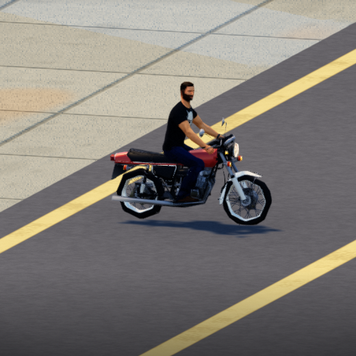 | 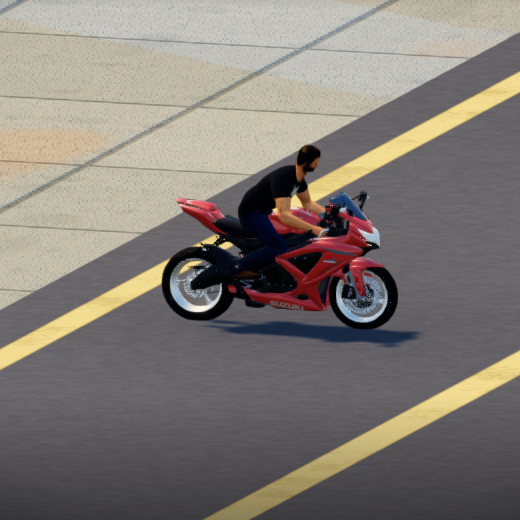 |
| M1 enduro — KR 500 | 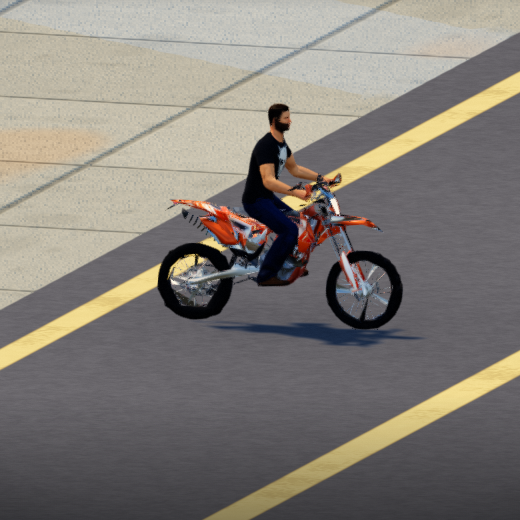 | 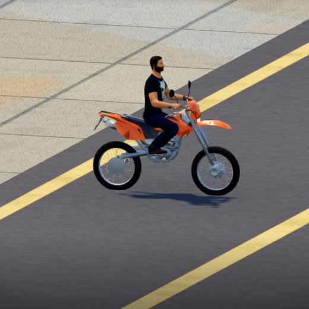 |
| S1 Jimny — RANGER variant | 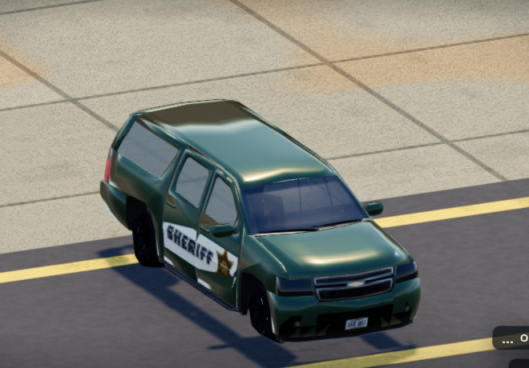 |  |
| S2 four-door SUV — RANGER variant |  | 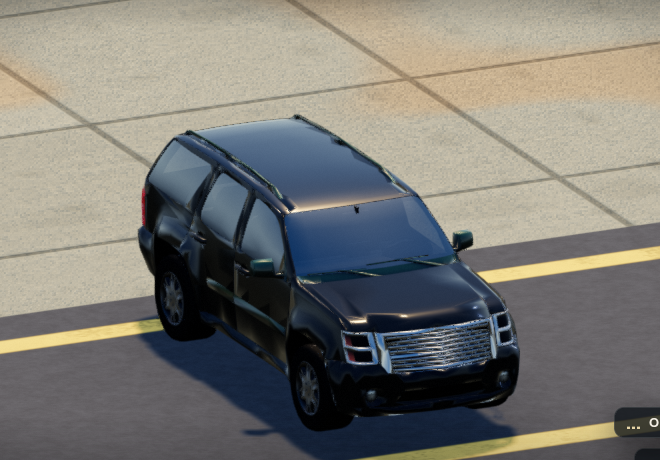 |
| S3 two-door offroad — RANGER variant | 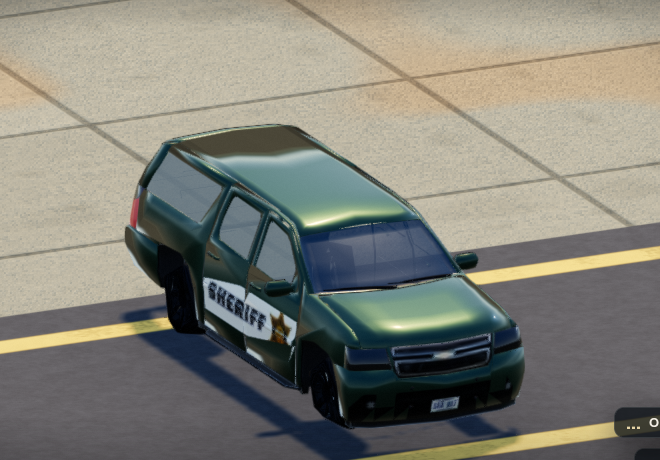 | 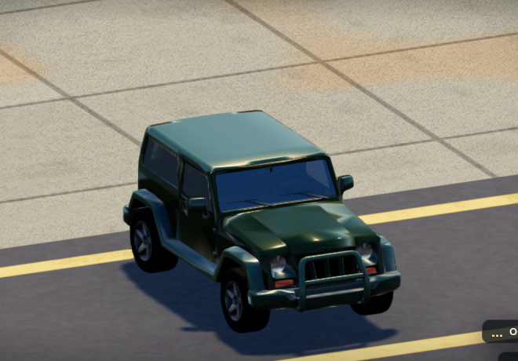 |
| S2 sheriff utility | 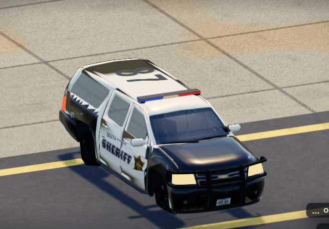 | 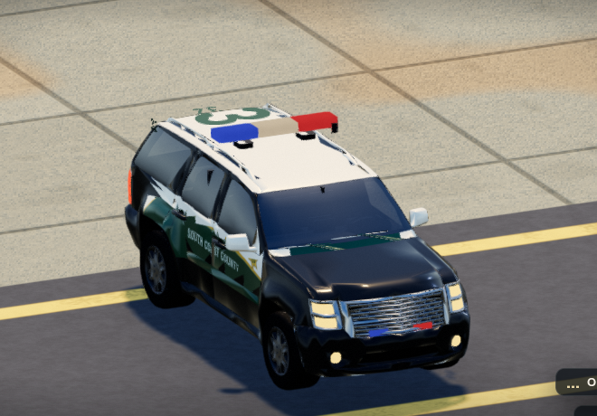 |

## Motorcycle normal chase views

| Vehicle | Before | After |
| --- | --- | --- |
| M2 sport — VORTEX 900 | 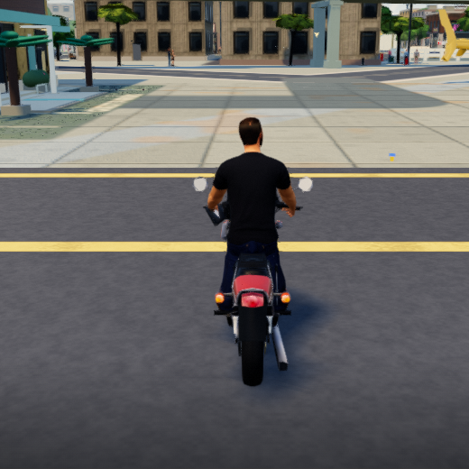 | 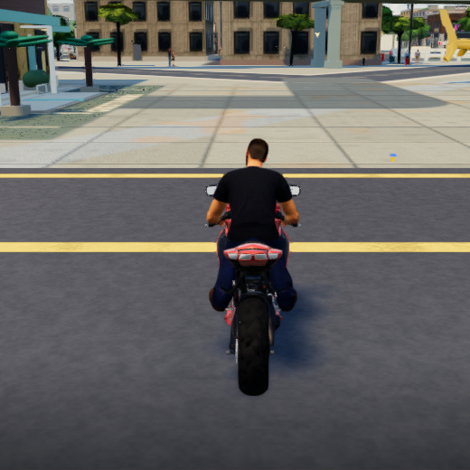 |
| M1 enduro — KR 500 | 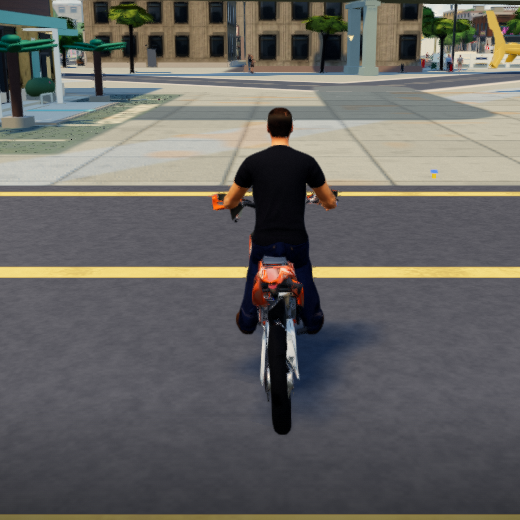 | 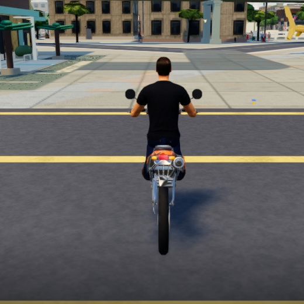 |

## SUV rear inspection views

These use an oblique inspection camera. They are distinct from the normal chase camera.

| Vehicle | Before | After |
| --- | --- | --- |
| S1 Jimny — RANGER variant | 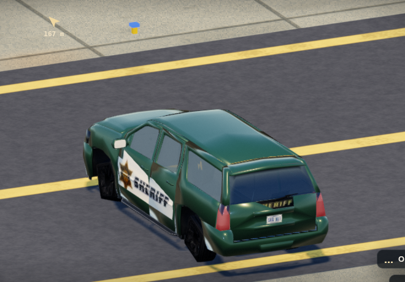 | 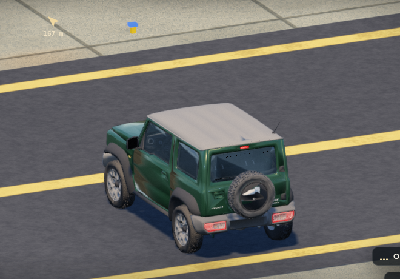 |
| S2 four-door SUV — RANGER variant | 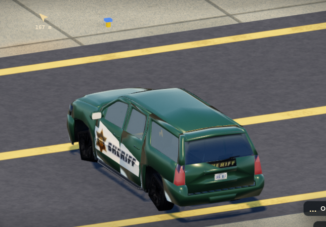 | 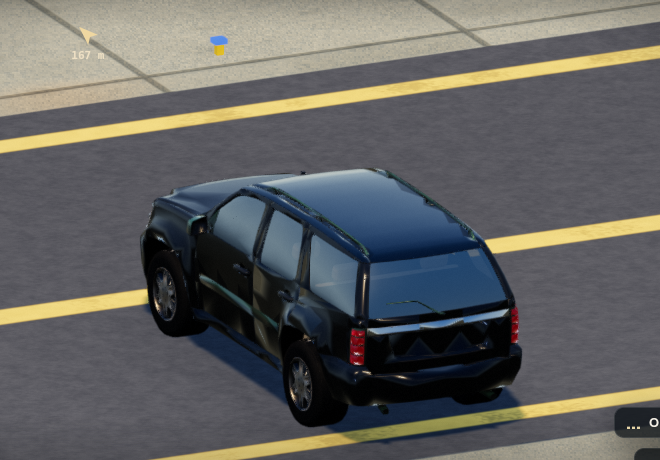 |
| S3 two-door offroad — RANGER variant | 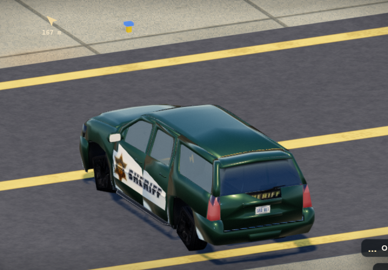 | 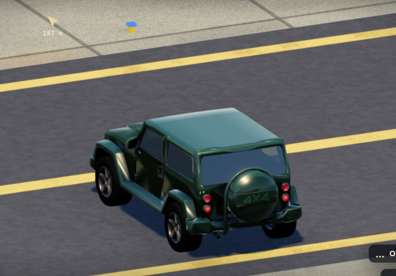 |
| S2 sheriff utility | 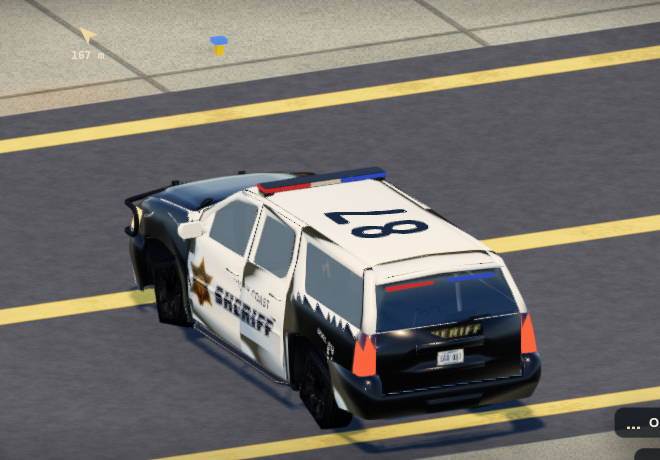 | 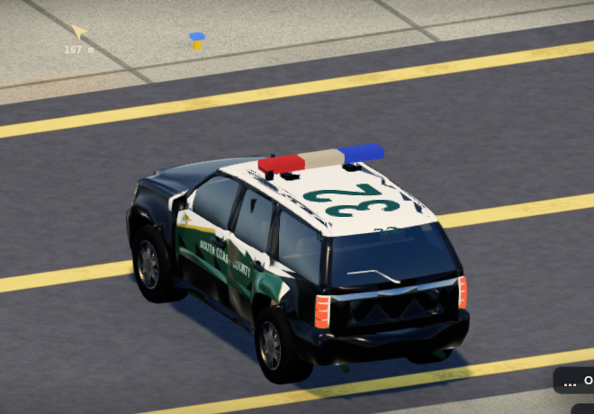 |

Movement, puncture, fire and repair screenshots are behavioral checks rather than exact
pixel comparisons. See the [motorcycle review](motorcycle-review.md),
[motorcycle screenshot manifest](motorcycle-screenshot-manifest.json), and SUV receipts
for the full states, preset checks and limitations.

## Rendering defects found and fixed during integration

These are actual earlier failing captures, with corrected in-game views. They are
behavioral comparisons; the reports retain their different input hashes. The patrol
fixture also changed to an explicitly selected sheriff look, as recorded in the manifest.

| Defect | Before fix | After fix |
| --- | --- | --- |
| Jimny source glass incorrectly opaque over lamps | 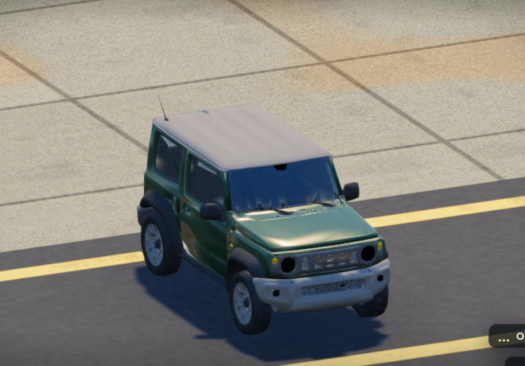 |  |
| S2 exterior roof and upper doors classified as trim | 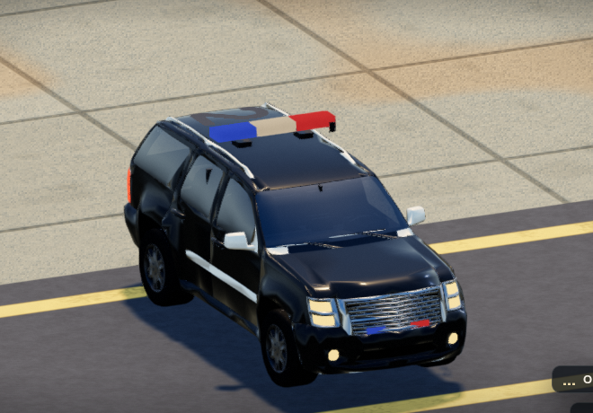 |  |
| Synthetic closed trunk lid covering repaired rear glass | 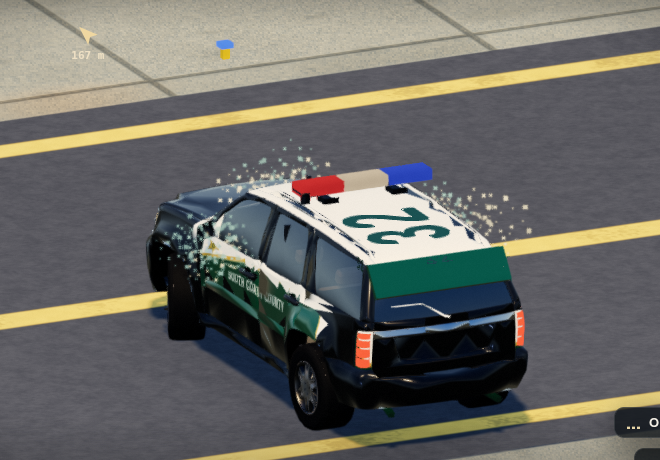 | 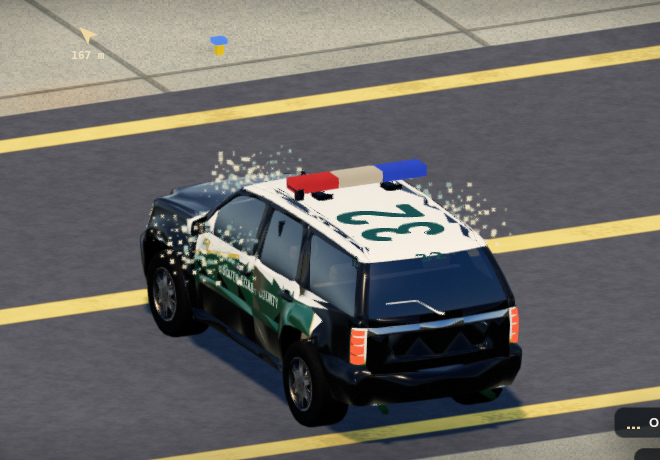 |

The final repair picture still contains ordinary fading shatter particles from the
preceding damage step; they are distinct from the repaired body and window geometry.
