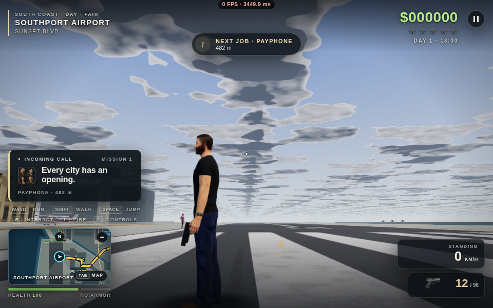
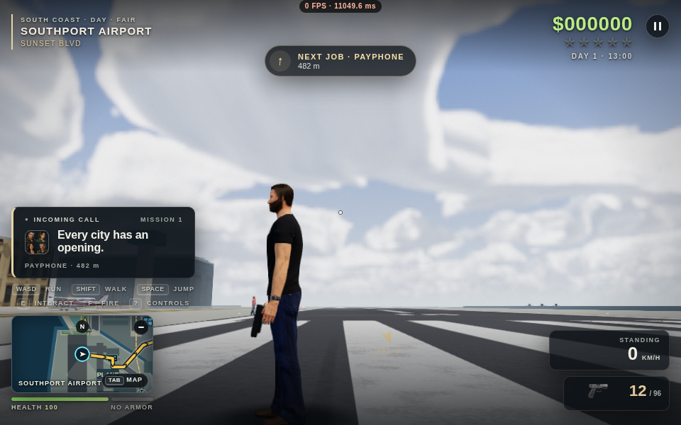
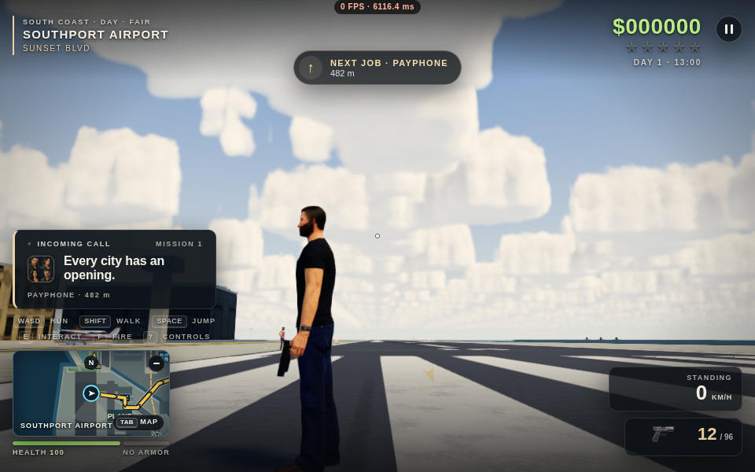
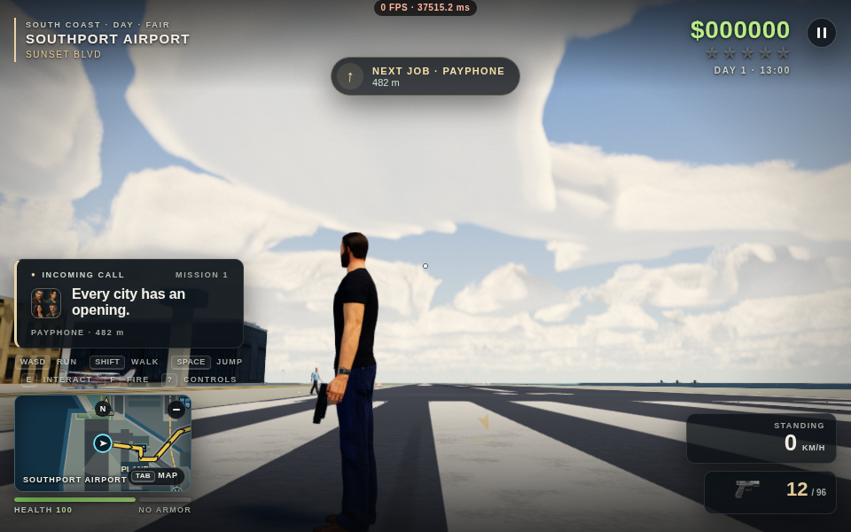
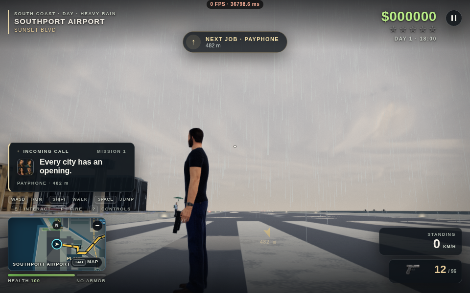
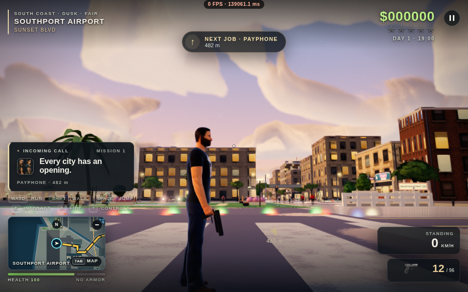

# Chase clouds and gameplay polish — 12 October 2026

Branch: `codex/chase-clouds-polish-2026-10-12`, based on `cbd5668` from the previous review.
This branch contains both earlier Codex review passes. Main remains unchanged.

## Implemented changes

1. **Volumetric chase clouds on every preset.** LOW/MEDIUM no longer project two flat slices
   across the sky. They integrate the volume at bounded lower pixel/step counts. HIGH/ULTRA
   keep finer lighting. Distant chase formations use broader, decorrelated sampling, reducing
   the obvious grid of repeated small cloud towers along the horizon.
2. **Cloud stability.** Temporal history follows wind and resets after abrupt weather, quality,
   camera or target-size changes. The original top-down/flight cloud field, altitude model,
   immersion and shadow functions retain their behavior. Distant chase sampling is explicitly
   a visual approximation; those distant silhouettes are not claimed pixel-identical to the
   overhead field.
3. **Camera cover clearance.** The shoulder/boom and upward close-wall lift respect canopy and
   elevated-deck slabs. Air underneath and above stays open. Tests include rotated slabs and
   the camera margin crossing a spatial-grid boundary. A tall vehicle's pivot is lowered
   beneath a ceiling before sweeping, so a pivot that starts inside the roof cannot trap
   the camera in that roof.
4. **Positional sound follows the chase camera.** Shots, sirens, engines, horns, footsteps,
   impacts, passing cars, venues and other positioned sounds pan to the visible side when the
   camera turns. The top-down mix, distance falloff, occlusion and Doppler remain unchanged.
5. **Weapons raise while aiming.** Holding right mouse or controller aim raises existing pistol,
   SMG and rifle poses before the first shot, using the existing pose blending.
6. **Reload continuity.** Reselecting the current weapon preserves an in-progress reload and
   avoids redundant save/UI work. Actually switching weapons retains its existing behavior.
7. **Clean retry/respawn transitions.** A world reset clears the renderer's remembered vehicle
   transition, avoiding a false door-exit pose at the new spawn.
8. **Correct ammunition guidance.** Empty guns direct players to gun shops, removing the stale
   instruction to find a nonexistent street ammo crate.
9. **Remembered job restart.** Save schema 12 remembers an unfinished/failed unlocked job after
   reopening the browser. RESTART CURRENT JOB starts that job from its beginning. It does not
   serialize a mid-stage checkpoint or restore an earlier inventory. Save/load preserves
   ammunition; restarting keeps the game's existing weapon restock. Wins/new games clear the
   choice; old saves and story/demo gates are respected.
10. **Ambulance detours.** A stuck free-roam ambulance near a safely reachable junction can plan
    around a stopped vehicle, considering both approaches to the patient. Three attempts,
    eight seconds apart, bound the work. It changes routes, never vehicle positions. Unsafe
    reversals, moving blockers and mission vehicles are excluded.
11. **Emergency drawbridge braking.** Ambulance steering now applies the drawbridge gate/span
    speed limit before collision protection has to stop it.
12. **Conservative rooftop culling.** Immutable rooftop solar panels are spatially grouped
    with exact copied transforms/materials, retained original pools and prewarmed fallback
    buffers. With shadows off, it uses chunks only when they reduce submitted instances without
    adding draws. Shadowed presets retain the original pools. See the measured A/B and final
    policy in the scenery documentation; this is not a claim of faster Ultra FPS.

## Cloud visual review

These are actual 960×600 Chromium captures from the seeded game, not generated artwork.
The fair-weather comparison uses the airport `(480, 4400)`, 13:00, chase heading 90°, pitch −12°.
The simulator is held between console-stepped draws; vehicle/pedestrian animation can differ
slightly between captures. This is visual review, not a pixel-identical full-scene comparison.
The FPS overlay reflects SwiftShader software rendering, not a laptop GPU.

| LOW before | LOW after |
| --- | --- |
|  |  |

| ULTRA before | ULTRA after |
| --- | --- |
|  |  |

| Storm, 18:00 | Sunset, 19:00 |
| --- | --- |
|  |  |

The additional absorption comparison (`cloud-depth-*`) is a rejected experiment, not a
shipped setting. Neither fair weather nor storms gained convincing depth from halving
absorption, and it could delay opacity early-out. The final build keeps the original extinction.
Cloud budget diagnostics now identify the tier actually drawn; the cloud benchmark rejects
a stale chase frame immediately after switching back to the overhead camera.

## Performance target and limits

The owner's target is comfortable Ultra play on an M4 Max, with other presets serving a wider
range of laptops. The provisional acceptance target is 60 FPS at a 1920×1080 scene buffer;
normal Retina/native-resolution windows must also be measured separately. No M4 Max is
attached here, so this review cannot certify that frame rate.

[The repeatable laptop profiling recipe](../laptop-profiling.md) records device, browser,
actual scene resolution, preset, frame-time distributions and fixed scenes/routes. Test
foreground gameplay, then held-scene A/B samples to attribute rendering work. Compare all
three samples, camera and shadow passes, and first-use hitches; do not report simulation
stepping or cloud software-GL wall time as hardware FPS.

## Validation and continuing work

The [verification record](verification.json) includes source hashes, passed test names and
the failures resolved during review. The final coverage is:

- **23 distinct logic regressions passed** across the focused run and targeted reruns, including
  camera/input, cloud history, audio, saves/retries, world resets, ambulances and bridge traffic.
  [Initial log](logic-initial.log), [rerun](logic-rerun.log).
- **Four rendered regressions passed**, including both cameras on Low/Medium/High/Ultra/Auto,
  effects, tier switching and the final cloud budget/history check. The early cloud diagnostic
  failure is retained in [the initial log](rendered-initial.log); [the corrected final run](clouds-final.log)
  reports 240×150/24 steps, 326×204/40, 480×300/64 and 480×300/96 at 960×600.
- **Rendered smoke passed with zero errors**: fresh-profile default FPS, real-key walking
  (16 units), driving (24 units), map, chase and return to street. [Smoke record](smoke.json).
  The Three.js packaging deprecation warning is pre-existing.
- **Flight handoff passed on the final source:** a 950 m jump restores the original flight
  cloud march and intact solar pool, with zero shader/console errors.
  [Capture](clouds-flight-final.png), [record](flight-final.log).
- **Randomized play:** 26 actions over 206 simulated seconds, no findings or crash. The
  180-second wall budget ended after an action at 187 seconds; this is a short run, not a soak.
  [Bot record](bot.json).
- Syntax/build/duplicate-declaration checks passed; all 13 media references resolve, ZIP CRCs
  pass, and its HTML matches the split build. [Package record](package-check.json).

The previous review's full-suite results are historical evidence, not a new full-suite run.
A real listening/motion review and hardware performance checks remain necessary.

This is an incremental polish pass toward the AAA goal. New animation asset collections,
full mid-mission checkpoints, broader combat/mission redesign and a claim of GTA/AAA parity
are not part of these implemented fixes. Completely boxed-in ambulances can still reach the
existing wait/offscreen/abort rules; a safe nearby junction is required for the new detour.

## Recommended next milestones

1. **Hardware acceptance runs.** Measure Ultra on the M4 Max at 1080p and a normal Retina
   window, then Low/Medium on integrated laptop GPUs. Record frame-time spikes as well as
   average FPS; use the attached profiling recipe before promising a performance tier.
2. **Animation and camera continuity.** Review vehicle entry/exit, reload, recoil, falls and
   tight-canopy framing in motion in both cameras. Preview any proposed replacement animation
   collection before importing it, and keep input response independent of animation completion.
3. **Transactional mission checkpoints.** Design stage snapshots with explicit actor, vehicle,
   timer, inventory and reward ownership before adding mid-job resume. The current remembered
   restart choice is intentionally much smaller and must not be mistaken for a checkpoint.
4. **Mission and combat readability.** Playtest mission stages without console shortcuts;
   prioritize readable threats, hit feedback, clear failure causes and reliable recovery over
   adding more systems. Extend traffic recovery only with physical, collision-safe paths.
5. **Environment art and lighting review.** Review clouds in continuous camera motion and at
   multiple times of day, along with horizon transitions, material consistency and shadow
   stability. Keep both camera views as acceptance scenes for every art change.

Claude should read `CLAUDE.md`, `docs/HANDOFF.md`, this report and the relevant area docs.
Merge this whole branch into an integration branch containing Claude's latest work, preserve
both sets of improvements, regenerate FILEMAP and rerun affected tests on that combination.
Do not move main until the owner reviews and approves the combined build.

The existing chatgpt.site deployment is not updated by this branch. The release workflow
also recognizes this review branch and publishes a commit-specific prerelease ZIP; only
main updates the rolling `latest` release. Verify the workflow result and asset before
sharing a download URL. To build locally, use `python3 tools/build.py --split-media dist/publish`
or the ZIP build command documented in CLAUDE.md.
