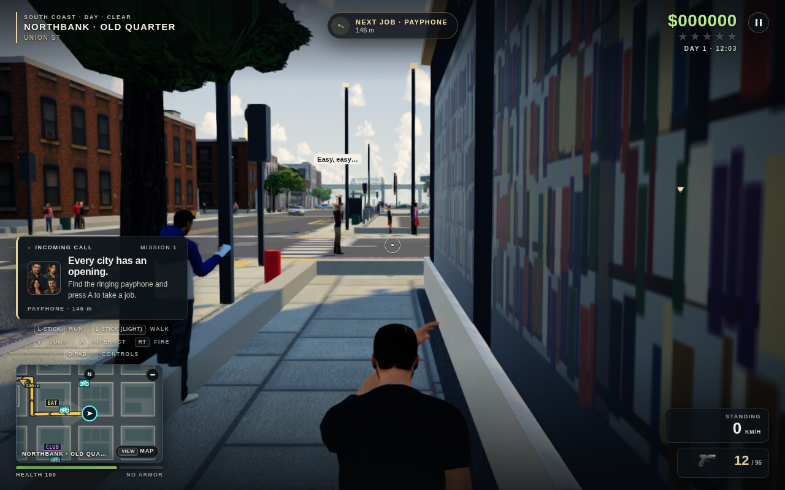

# Dead End City: bug and efficiency review, 11 October 2026

Base: `origin/main` at `9afe59d` (the October 11 game update). Review branch: `codex/game-fixes-2026-10-11`. Main has not been changed.

## Changes

1. **Chase camera wall clearance.** The shoulder offset is collision-tested before the camera boom, and the near plane's width contributes to clearance. Removing the old minimum boom length prevents it pushing the camera back through an adjacent wall while aiming. Checks cover three headings along a real Northbank facade and the existing camera-comfort scenarios.
2. **Open vehicle windows.** Shattered and rolled-down panes no longer become opaque black panels. They leave an opening onto the modelled cabin and occupants. Repair restores the pane; intact windows on the other side remain. The solid material is retained for trunk wells and burnt roofs.
3. **Driver feet inside the car.** Low fitted seats previously put the ankle targets near or below ground level, leaving shoes visible under the chassis. Both seated occupants and the drive-by pose now use ankle targets above the cabin floor. The seat and headroom fit are preserved.
4. **Touch HUD layout.** Police dispatch captions sit below the measured mission card and navigation pill in both camera views. Switching touch controls invalidates the old layout measurements. The reproduced 46-pixel overlap becomes an 8-pixel gap at 960×600.
5. **Surrender controls.** Holding movement, steering, jump or fire no longer advances the voluntary-surrender timer merely because a wall or obstruction prevents movement. Releasing the controls still permits surrender.
6. **Vehicle paint updates.** Compare wear, heat and paint colour separately, removing the temporary cache-key string for each visible car on every frame. This also fixes two different wear/heat states producing the same old key and leaving the wrong finish on the car. Resprays still update correctly.
7. **Vehicle material lifetime.** Repaired burnt cars return materials to bounded reuse pools. Materials beyond each pool's 12-item limit are disposed, releasing their renderer program references instead of leaving them allocated.
8. **Trustworthy review tools.** Renderer-only checks now report SKIP when WebGL is disabled. The regression runner honours the requested comparison HTML and waits for the previous server to stop. Smoke tests and screenshot tours fail on runtime errors and close their browser even on failure; boot timeouts accommodate the full asset build. The rider-fall check uses a quiet airport wall after the old city route became affected by live traffic; its injury and blood assertions are unchanged.
9. **Parked-car physics while bridges are raised.** A raised drawbridge previously disabled the parked-car settle shortcut across the entire city. The shortcut now checks the same nearby raised span as the full settle, preserving bridge behaviour while avoiding unrelated work elsewhere.
10. **AUTO resolution floor.** After recovering from 60% to 65%, AUTO could subtract 10% and fall to 55%, below its intended minimum. Downward steps now clamp to 60%.
11. **Separate review downloads.** Every branch build uploads a ZIP artifact. This review branch also publishes a public, commit-specific prerelease download. Only main updates the rolling `latest` release, and branches have separate workflow concurrency groups, preventing a review push from replacing or cancelling another branch's build.

## Efficiency evidence and limits

- Paint-state comparisons remove one temporary string per visible vehicle per frame. They apply independently of the chosen graphics tier and camera.
- A material lifecycle check releases 60 retired materials: 36 enter the three capped pools and all 24 overflow materials dispatch their disposal event. The original code disposed none of the overflow.
- Missing window panes submit no colour or depth draw through their hidden material.
- The original parked-car audit checked 2,700 shortcut uses with bridges closed and zero with them raised. With the fix, the audit checked 2,680 shortcut uses with bridges closed and 2,660 with them raised, with zero differences against the full settle. Traffic, access and timetable checks also passed.
- The isolated paint helper benchmark uses real Three.js materials and 524,288 cached calls per round. Raw measurements are saved alongside this report. They are microbenchmark results, not a claim about whole-game FPS.
- The cloud runs Chromium with SwiftShader software rendering. It can prove rendering paths and resource behaviour, but cannot establish smooth laptop GPU frame rates. Hardware testing at 1080p, while driving through dense streets and during rain/night pursuits, remains necessary. AUTO remains the sensible starting setting; HIGH and ULTRA cannot be guaranteed on every laptop.

## Verification

Combined coverage is **153 distinct checks passed, 12 renderer scenarios not run, and no unresolved test failures**. This is combined evidence from the full regression run and the targeted rendered/follow-up runs, not a claim that every graphical scenario was exercised.

- The complete 164-test regression set ran in two frozen 82-test worktrees at `953c1eb`: **149 passed, 12 skipped, 3 failed** initially. The later seated-feet rendering change and its pose reporting were verified on the final game source, `682edae`.
- `living-medics` initially aborted because traffic boxed in the ambulance; it passed on a fresh run without changing its assertions. This does not resolve every possible ambulance traffic blockage.
- `wheelie` initially failed its real-time key check under shared load; it passed with the rendering jobs stopped, without changing its assertions.
- `rider-falls` failed on nearby blood and, on a second city run, unexpected injury. The old Exchange route also gave inconsistent health/death results on unmodified main. Its replacement airport building run passed on both main and this branch, retaining the same speeds, durations and injury/blood assertions. The route comparison and original failures are saved here.
- Dedicated WebGL checks passed for all five graphics settings in both views (960×600, DPR 1), broken/lowered windows and repair, AUTO's 60% floor, and seated/drive-by shoe clearance. The final foot measurements are 9.3–9.5 cm above the posed cabin floor. Three renderer-only checks previously labelled PASS on a no-render page now correctly report SKIP.
- The split build passed boot, walking, driving and map smoke checks with **0 runtime errors** and five captures. All **9 radio tracks loaded**, with **0 failures**. The final split-build vehicle capture tour also booted and finished with **0 errors**.
- Syntax, duplicate declarations, file-map and conflict checks passed. The final package contains all **13 media references**, and the ZIP passes CRC validation. `build-check.json` records the local archive hash; CI can produce a different ZIP hash because archive timestamps differ.

The full regression snapshot is `953c1eb`; the initial graphics matrix and window check used `4b200cc`; the final rendered feet, AUTO and split-build capture checks cover the game source at `682edae`. No gameplay logic changed after the full-suite snapshot. Later changes concern seated rendering, console reports, test fixtures, documentation and the review download workflow.

See [per-test results and source snapshots](verification.json), [full run A](regressions-a.log), [full run B](regressions-b.log), [follow-up checks](isolated-reruns.log), [final render checks](final-render-checks.log), [vehicle captures](vehicle-visual-checks.log), [smoke](smoke-check.log) and [audio](media-check.log). The cloud browser serves files over loopback HTTP; direct `file://` playback is not tested in this managed environment.

## Screenshots

Actual browser captures. The world comparisons use 1280×800, HIGH, 80% render scale and a clear midday sky. Traffic and animation timing differ between captures. The touch comparison isolates the actual HUD at 960×600 with world rendering disabled; its black background is intentional.

| Issue | Original main | Review branch |
| --- | --- | --- |
| Camera intersects the facade while aiming | [Before](camera-before.png) | [After](camera-after.png) |
| Shattered window becomes a black panel | [Before](windows-before.png) | [After](windows-after.png) |
| Shoes protrude below the sedan | [Before](feet-before.png) | [After](feet-after.png) |
| Touch dispatch overlaps the mission card | [Before](touch-before.png) | [After](touch-after.png) |

## Playable build and hosting

The split web build is `dist/publish/index.html` with its complete `media/` directory. The downloadable package is `dist/DeadEndCity.zip`; build outputs are intentionally excluded from Git. The branch workflow uploads that ZIP as a GitHub Actions artifact named `DeadEndCity-<commit>` and, for this review branch only, a public prerelease tagged `codex-review-<first 12 commit characters>`. Extract the ZIP and open `DeadEndCity/index.html` to play locally. Start with AUTO graphics; press V to switch cameras. Public review downloads appear in the [repository releases](https://github.com/starfox22/GTA/releases?q=codex-review-); they are marked as prereleases and do not replace main’s `latest` download.

This Codex session has no Sites deployment tool or credentials for `dead-end-city.maxpayne22.chatgpt.site`. That site has not been updated by this review. A successful build or GitHub push does not imply a Sites deployment.

## Suggested next work toward the larger game goal

- Profile real laptop GPUs in both views, then reduce the remaining city-wide prop, crowd and shadow draw costs using measured budgets.
- Improve ambulance routing when traffic boxes in the responding vehicle; the intermittent failure remains visible in the original regression log.
- Address first-use shader/asset hitches when entering chase view or changing graphics quality before rain.
- Improve very tight-corner camera framing and test ultrawide and small screens with real pointer, controller and touch input.
- Finish visible interaction details already noted in the backlog: van/SUV tailgate animation, the carried summit package, passenger seating and cockpit/interior detail.
- Plan cover behaviour and more mission content as separate design work. This pass fixes the existing game; it does not establish AAA feature or performance parity with GTA.
