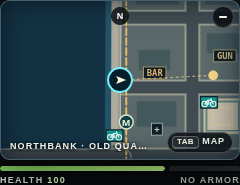
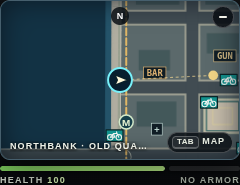
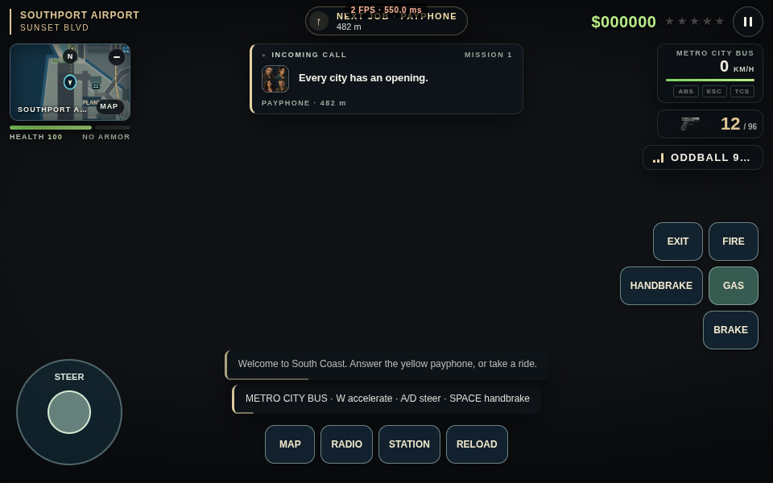
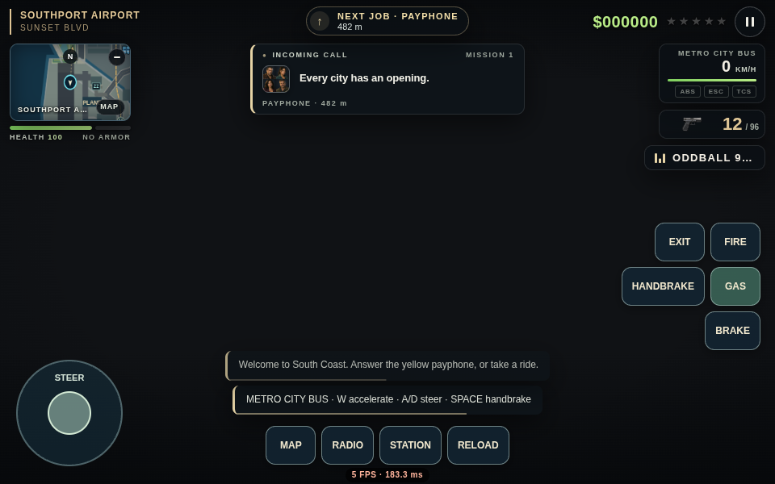
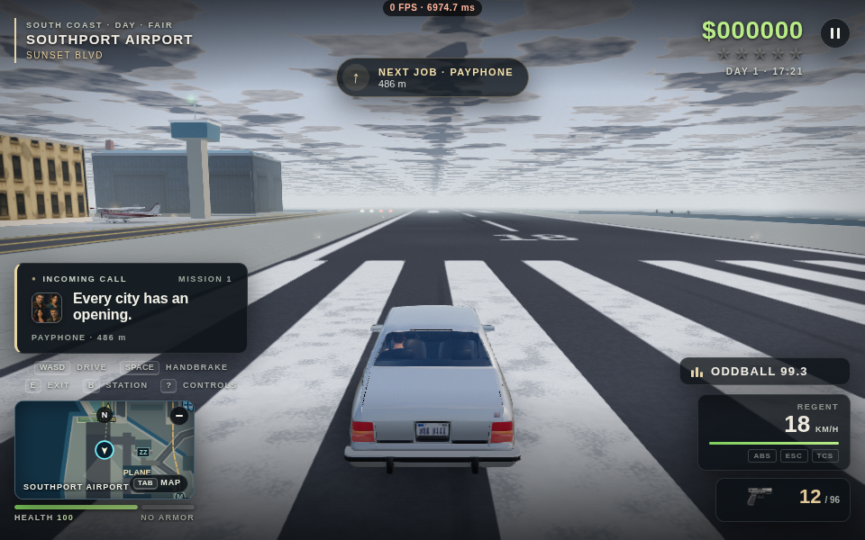

# Dead End City: follow-up bug and efficiency review, 12 October 2026

Branch: `codex/game-polish-2026-10-12`. Base: the previous review at `370c1cf`, which already
contains main's October 11 version 62 (`9afe59d`). This branch includes the October 11 fixes.
Main is unchanged by this review. See [the earlier report](../game-review-2026-10-11/README.md)
for those inherited changes; the list below covers this follow-up only.

## Changes

1. **FPS on by default.** Fresh profiles show FPS and average frame time. An explicit saved off
   preference remains respected, and blocked browser storage does not disable the counter.
   Loading, hidden-tab time and console-stepped simulation no longer contaminate its sample.
   The first value appears after a half-second sample of live frame intervals.
2. **FPS layout.** The desktop counter sits above the waypoint without overlap; touch mode places it below
   the buttons. Enabling the old counter exposed a 14-pixel overlap with the touch waypoint.
3. **Independent mouse buttons.** Releasing left fire keeps held right aim/secondary fire active,
   and releasing right keeps held left fire active. Middle-button release changes neither.
4. **Input after focus and menu changes.** Blur and hidden tabs clear physical/virtual keys and
   both mouse buttons. Pause, help and the map discard both held firing buttons, preventing
   a missing release outside the game from leaving aiming or secondary fire active on return.
5. **Night-traffic light capacity.** Analytic headlamps still need tail glows, so counting only
   head quads could exceed the tail buffer. The dense fixture produced 164 tail instances for
   a 160-instance allocation; the corrected limit stays at 160.
6. **Smaller GPU uploads.** Distant cars, debris, road-light quads and beam haze upload their
   current visible prefix. Persistent decals upload the changed span and preserve all pending
   writes across skipped draws and circular-pool reuse. Geometry, materials and quality tiers
   retain their detail.
7. **Bike-share map visibility.** Icons now use the actual map viewport. Stations near a visible
   minimap edge no longer disappear, including during speed pullback. Panned/zoomed city maps
   avoid painting offscreen stations.
8. **GPS lookup cost.** Nearest-road-node searches keep at most 18 ordered candidates instead
   of allocating a record for every graph node and sorting the full graph. Equal-distance ties,
   obstruction-probe order and the nearest-node fallback retain their original behavior.
9. **More reliable smoke checks and handoff.** The rendered smoke check asserts actual walking
   and driving displacement, default FPS visibility, map transitions, and both camera modes.
   It saves six screenshots and a structured failure/success report. The central HANDOFF now
   points to both Codex reviews and explains how to integrate with concurrent Claude work.

## Efficiency evidence

The rendering unit check executes the production functions with real Three.js r160 attributes
and the shipped WebGL uploader, recording transferred bytes in a GL shim for both WebGL1 and
WebGL2. These are exact fixture transfer sizes after initial allocation, not whole-game FPS:

| Fixture | Previous transfer | Updated transfer |
| --- | ---: | ---: |
| One changed world decal | 201,600 bytes | 84 bytes |
| Two debris pieces | 53,200 bytes | 152 bytes |
| Three body and five box vehicle impostors | 101,760 bytes | 928 bytes |

The host navigation comparison covers 1,604 queries and 6,391 visibility probes, including
ties, no connected nodes, fewer/more than 18 candidates, fallback, and the strict distance
threshold. The map painter has four viewport-edge and offscreen cases. The generated world
also has its own `navigationAudit(120)` regression.

## Verification

- The focused regression group passed **17/17, no skips or failures**, covering FPS default and
  persistence, mouse events, GPU-upload ranges, actual-world navigation, HUDs, camera input/aim/
  walking/view persistence, entering, surrender, vehicle layouts and world reset.
- The seeded before/after run produced equal simulation hashes after each of five stages:
  walking, driving, pursuit, map and pause. It compares this pass against `370c1cf`, not main.
- The actual 4,055-node road graph matched the reference in all 120 node selections and all
  318 obstruction probes, with unchanged simulation state. Its timing figures are diagnostic
  samples, not a whole-game speedup claim.
- The mixed-action bot ran **43 actions / 96 simulated seconds / 183 wall seconds**, with no
  findings. Its selected actions covered vehicles, walking, menus, gamepad, mouse fire, camera
  switching and graphics/settings. The five-minute target was cut short by the explicit
  180-second wall-time budget; save/reload was eligible but was not selected in that random run.
- The first 1280×800 rendered smoke reached play with the default counter visible, but the
  walking check timed out after 60 seconds on software GL. The no-render control moved 37 units
  with real W input in two seconds. The rendered retry retains the 16-unit walk and 24-unit
  drive assertions at 960×600 with a 240-second movement allowance; the original failure is
  preserved in `smoke-initial-timeout.json`.
- The 960×600 rendered retry passed with 0 runtime errors: 16 units of actual walking,
  24 units of actual sedan driving, map open/close, chase view and return to street view.
  The default FPS readout was visibly enabled; six screenshots and `smoke.json` were saved.
  The one Three.js deprecation warning is expected. Vehicle boarding uses a named console
  fixture; this smoke does not claim to test the car-theft interaction.
- The rendered regression group passed **3/3, no skips or failures**, including all five
  graphics settings in street and chase views, effects drawing, and switching quality tiers.
  It reused the 960×600 browser. Software GL exercises the immediate tier-switch fallback;
  asynchronous prewarming on hardware remains a separate profiling task.
- Syntax, build, duplicate declarations, FILEMAP freshness and conflict-marker checks passed.
  The playable ZIP passed CRC checks and contains all 13 media files referenced by the tested
  split HTML; its HTML matches the smoke-tested build byte for byte.

The final rendered results and exact commands are recorded in `verification.json` and the adjacent logs.
This is a targeted follow-up pass; the October 11 full-suite results are separate historical
evidence and are not relabelled as a new full-suite run.

Cloud Chromium uses SwiftShader software rendering. Browser integration checks verify rendering
paths and runtime behavior; their FPS values do not predict a laptop's GPU performance. Hardware
profiling at 1080p in dense traffic, night rain and both cameras is still needed before promising
smooth HIGH/ULTRA play on a particular laptop. The efficiencies here do not lower preset quality.

## Actual browser screenshots

The cropped minimaps below come from the same seeded world, player `(104, 587)`, station 0 at
`(904, 587)`, zoom 1. The old 700-unit gate omitted the station although it was within the actual
876-unit horizontal half-view. Look at the bicycle icon on the right edge beside the yellow
payphone marker. These are actual canvas captures; the no-render page isolates the UI.

| Before | After |
| --- | --- |
|  |  |

The touch HUD captures below isolate the UI with 3D drawing disabled. The original counter
was explicitly enabled for the comparison. Its 14-pixel waypoint overlap is gone; the counter
now sits below the controls. The black world background is intentional, and the FPS values
in these cloud screenshots are not laptop performance measurements.

| Before | After |
| --- | --- |
|  |  |

### Remaining graphical defect: repeated clouds near the horizon

The rendered chase screenshot below exposes a pre-existing repeated cloud grid on LOW/AUTO.
LOW and MEDIUM share the two-slice cloud approximation in `clouds3d-sky.js`. The noise field
tiles every 275 metres and its coverage every 1.125 kilometres; near-horizontal rays make
the repetition conspicuous. This remains unresolved and is recorded in `docs/BACKLOG.md`.
The fix should reduce repetition in the shared sampling and filter the distant horizon,
with checks across weather, shadows and both cameras. Enabling the expensive volumetric
path on LOW would undermine the laptop-efficiency goal.

This is an actual rendered browser capture. The counter rounds the software renderer's
approximately 0.14 frames/second to `0 FPS`; it does not describe laptop performance.

## Recommended next work toward the AAA goal

1. **Set measurable laptop frame budgets.** Profile integrated and dedicated GPUs with repeatable
   1080p routes in both views. Track 95th/99th-percentile frame time, GPU time, memory and first-use
   stalls. Then spatially partition the remaining city-wide instanced prop pools so offscreen
   scenery does not add vertex/shadow work. Keep an image comparison gate for each preset.
   Review bounded physics substeps too: the current per-frame simulation cap slows game time
   below roughly 30 rendered FPS; a lower frame rate should not change driving or combat speed.
2. **Improve animation and interaction continuity.** Prioritize enter/exit transitions, turning,
   aiming and weapon handling, passenger seating, visible tailgates and the carried mission
   package. Use licensed ready-made assets and review previews before integration.
3. **Make traffic and emergency behavior recover reliably.** Add jam escape, intersection
   coordination and ambulance rerouting with repeatable blocked-road scenarios. The prior
   ambulance regression's intermittent blockage remains open.
4. **Develop combat and mission depth as designed features.** Cover/over-cover fire, clearer enemy
   reactions and encounter roles, checkpoints and a small set of highly polished missions would
   contribute more than expanding the map before existing interactions are dependable.
5. **Polish camera, audio and device consistency.** Review close-wall camera framing, controller
   aim and remapping, touch safe areas, motion-comfort defaults, positional ambience and vehicle
   sounds. Validate new effects against frame budgets before adding them across the city.

These are recommendations, not implemented features or a claim of GTA/AAA parity.

## Continuing and integrating

Read `CLAUDE.md`, `docs/HANDOFF.md`, this report and the relevant area docs. Commit Claude's
current work, create an integration branch from it, then merge
`origin/codex/game-polish-2026-10-12`. Preserve both sets of improvements when resolving overlaps,
regenerate FILEMAP, and rerun affected tests and rendered checks on the combined source. Keep
main unchanged until the owner reviews and approves that build.

Build outputs are ignored: `python3 tools/build.py --split-media dist/publish` produces the HTML
and complete media directory; `--zip dist/DeadEndCity.zip` produces the local playable package.
Branch pushes produce a GitHub Actions ZIP artifact. This follow-up does not update the existing
chatgpt.site website or replace main's public release.
