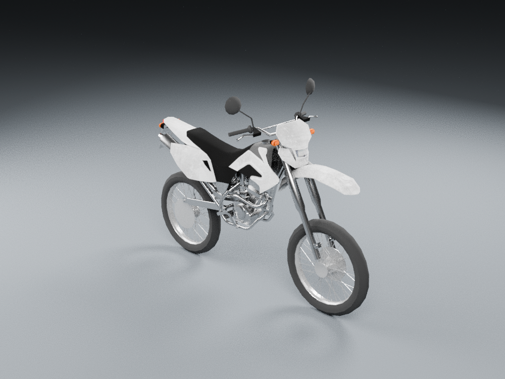
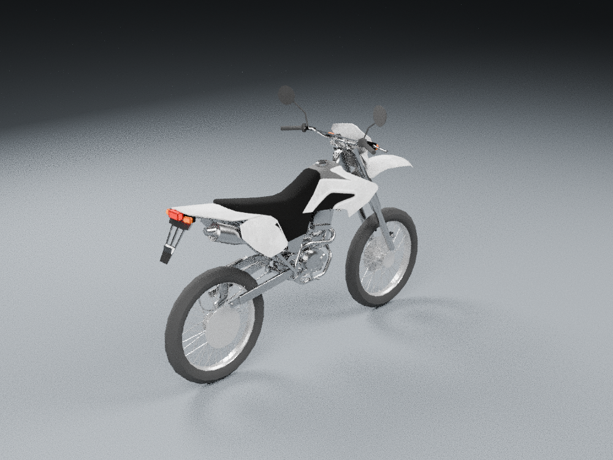
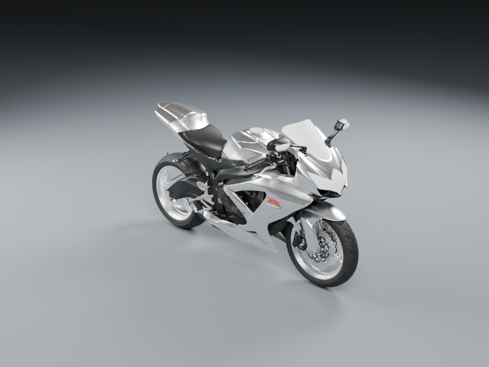
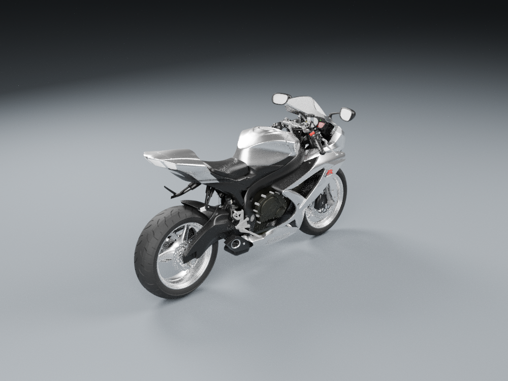
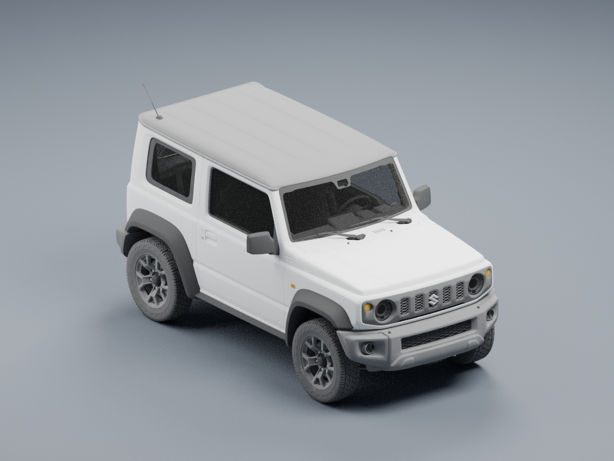
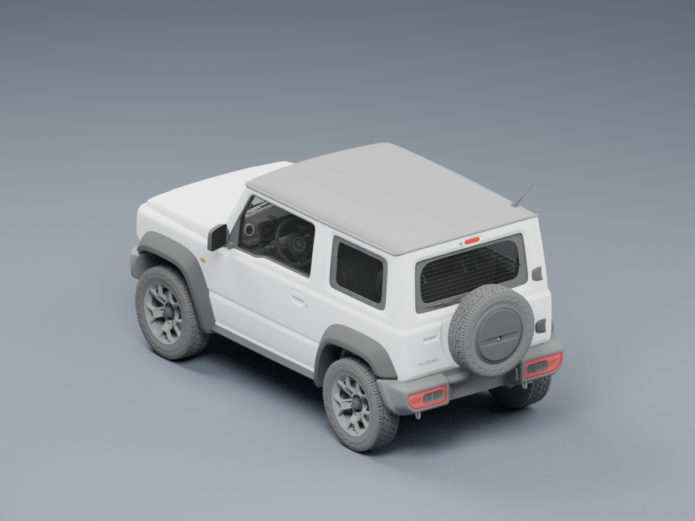
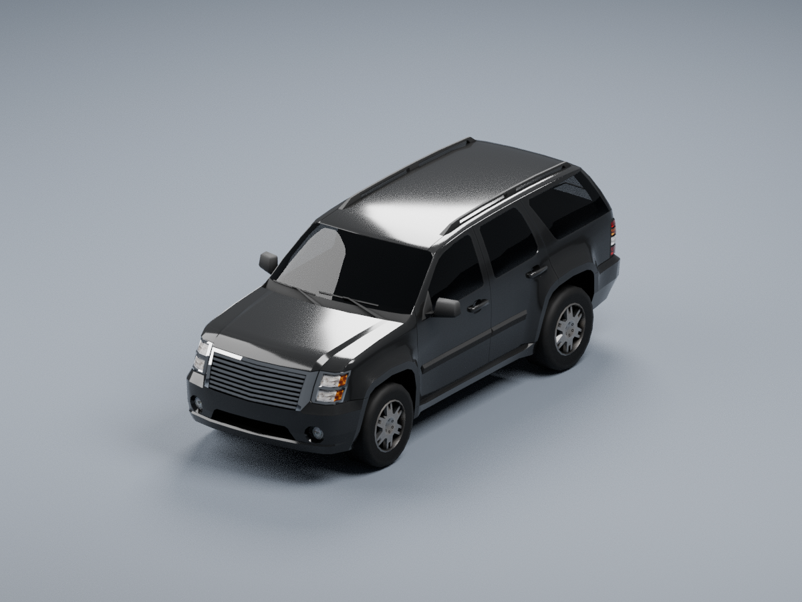
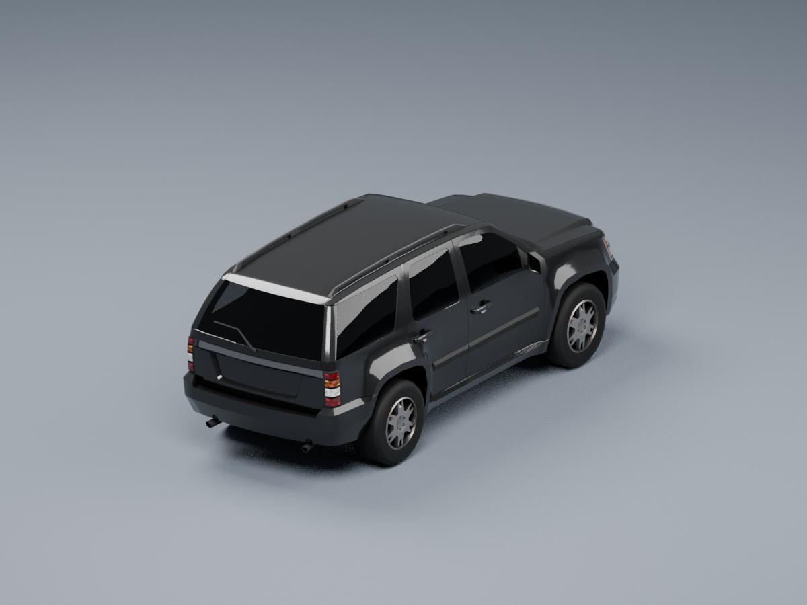
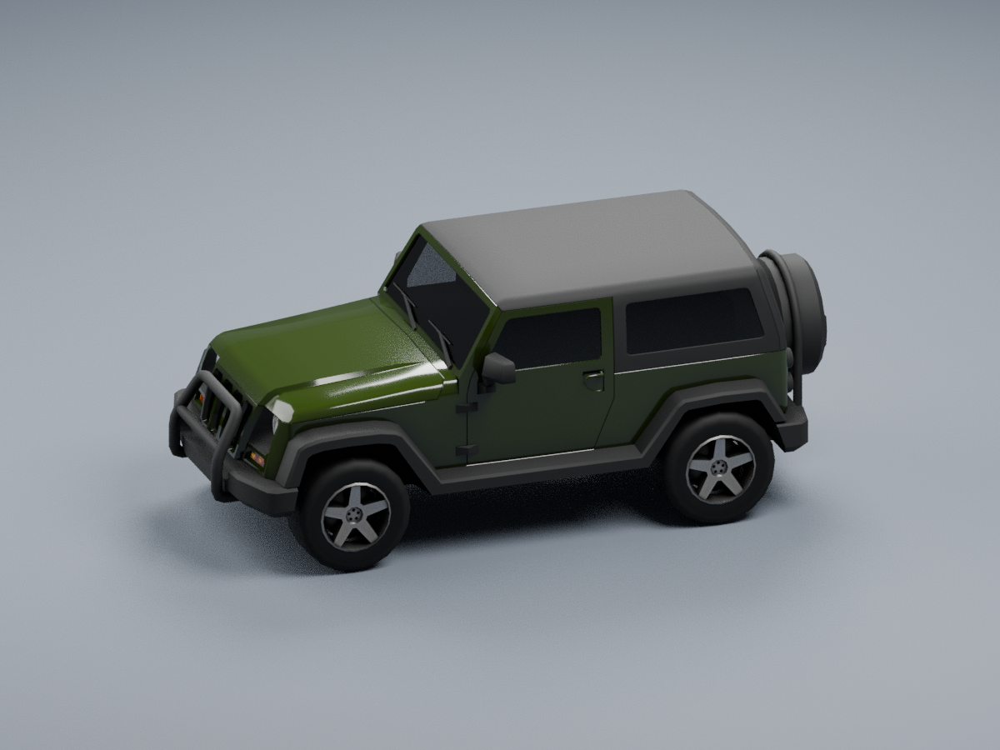
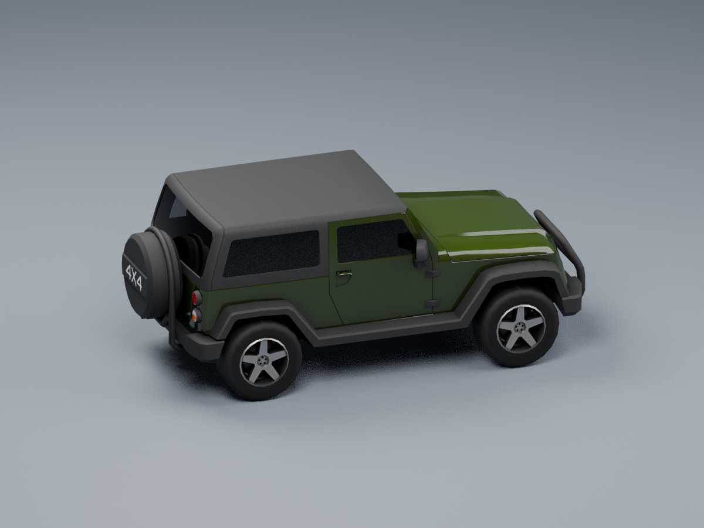

# Free replacement vehicle shortlist

Owner request: find new motorcycle and sheriff/RANGER 4X4 assets, show previews,
and obtain individual approvals before importing. **Free assets only.** All work
continues on `codex/chase-clouds-polish-2026-10-12`. This proposal changes documentation
and preview images only; no game models, source code or production credits are changed.

These are native Blender renders of actual downloaded model copies. They show the
existing geometry/materials under neutral studio lights, with front and rear views.
They are source-model previews for appearance approval. Grain is render sampling,
not an authored texture. No images are generated from descriptions or retouched.
SUVs are shown before adding the game's sheriff livery, emergency lights or equipment.

## Candidates

| ID | Model / creator | Source triangles | Assessment |
| --- | --- | ---: | --- |
| **M1** | [Real Motorbike 02](https://sketchfab.com/3d-models/real-motorbike-02-unity3d-f24e366933c54835b562e5210d93047f), jsa201077 / unityjsa7 | 12,351 | Practical dual-sport/enduro replacement base. Separate body, fork and wheels; 1K albedo. Conventional 1980s/1990s-like silhouette, exact year unknown. Materials still need polish. |
| **M2** | [Sport motorcycle](https://skfb.ly/oIYFv), nouter2077 | 403,396 | More detailed sport-bike geometry. The accessible copy has 38 scalar materials and no texture maps; chrome-white panels and pale windscreen are its actual current finish. Requires baking, material work and LODs. Angular styling appears modern; the `Srad750` node name does not establish a 1996/1997 year. |
| **S1** | [2023 Suzuki Jimny Sierra](https://sketchfab.com/3d-models/2023-suzuki-jimny-sierra-8b7c4d136f6742e180faf654d874f14a), tonielpro520 | 456,991 | Strongest detailed SUV source found: tyre tread, rims, lamps and visible dashboard/steering/seats. Modern compact two-door, rather than a full-size patrol SUV. Needs major LOD/rig/material consolidation work. Approval must account for the 2023 design in a 1997 setting. |
| **S2** | [Generic passenger car pack: SUV](https://sketchfab.com/3d-models/generic-passenger-car-pack-20f9af9b8a404d5cb022ac6fe87f21f5), Comrade1280 | 7,951 | Lightweight four-door body with separate wheels and 1K base-colour/metallic-roughness textures. Modern Escalade-like styling; modest detail and no confirmed detailed cabin. A budget alternative, not hero-quality artwork. |
| **S3** | [Generic passenger car pack: Offroad](https://sketchfab.com/3d-models/generic-passenger-car-pack-20f9af9b8a404d5cb022ac6fe87f21f5), Comrade1280 | 6,502 | Lightweight two-door Wrangler-like alternative, with separate wheels and 1K maps. Modern proportions and simpler detail. Less substantial than S1. |

My practical starting choice is **M1 for an enduro**, and **S1 for a detailed county
4x4 if the owner accepts its modern/compact body**. M2 is a sport-bike geometry choice
with a substantially larger preparation cost. S2/S3 are efficient alternatives whose
art should be accepted on its own merits. None has been validated inside this game;
these source counts are not the proposed shipping budgets or laptop FPS measurements.

## Front and rear previews

| Candidate | Front | Rear / chase-facing side |
| --- | --- | --- |
| M1 |  |  |
| M2 |  |  |
| S1 |  |  |
| S2 |  |  |
| S3 |  |  |

## Licence and source evidence

All five copies were publicly downloadable without purchase. Current marketplace
prices/availability were not checked: Sketchfab and other asset catalogues are
blocked by this cloud's network proxy. GitHub sources and actual model files were read.

- **S1, S2, S3:** model-specific GLB metadata embeds the creator, original source URL
  and **CC BY 4.0**, independently inspected. This is stronger than a code repository
  licence. The original marketplace pages were not accessible.
- **M1, M2:** their repositories explicitly credit the identified motorcycle assets
  as **CC BY 4.0**, separately from code and other data. The original creators' pages
  remain unverified. Appearance approval does not replace that source-licence check
  before production integration. Unrelated NC/restricted assets from those repositories
  are excluded.
- Attribution for these preview adaptations: M1 is based on Real Motorbike 02 by
  jsa201077; M2 on the motorcycle credited to nouter2077; S1 on 2023 Suzuki Jimny Sierra
  by tonielpro520; S2/S3 on Generic passenger car pack by Comrade1280. Original links
  are in the table. Licence: [CC BY 4.0](https://creativecommons.org/licenses/by/4.0/).
  Preview changes are camera/lighting, coordinate normalization, faithful prefab
  assembly for M1, and codec-only Draco decoding for S1. Source geometry and materials
  were retained. These are render adaptations made for review, not claims of original authorship.

M1 evidence: [asset-specific VGFramework credits](https://github.com/vimontgames/vgframework/blob/b3173a3814790af7061f1949437a3c958b00000b/README.md).
M2 evidence: [asset-specific Nonplanar-Vehicle-Control credits](https://github.com/thomasfork/Nonplanar-Vehicle-Control/blob/8cb0ee51e2cf5cf7b3abbf21d3bdadc538a6c672/README.md).
[Candidate metadata](candidates.json) and [native image hashes](preview-inputs.json)
record downloads, source hashes, material limitations and exact images. Original
source model files remain outside the game/repository pending selection.

## A period-compatible SUV lead

[1989 Chevrolet Suburban](https://sketchfab.com/3d-models/44bdb8317f0840b3bc858e606f86db6b)
by Randomness / throwbackthursdaymodels is listed with CC Attribution in a public car
catalogue. It could fit the setting/body role better than the modern alternatives.
However, that repository excludes the actual GLB, and the creator page is blocked here.
No preview, source geometry, provenance, interior or licence grant was independently
checked. It is a **lead**, not a verified replacement. [Exact available evidence](suburban-1989-lead.json).

## After approval

Preserve the selected asset's close-view detail and authored material channels.
The current converter retains only base-colour images, defaults atlas tiles to 512px,
and aggressively reduces several motorcycle parts. Simply passing a better model
through those same settings can lose the improvement. Build explicit near/far LODs,
retain tyre/steering pivots and rider contacts, adapt the sheriff equipment where needed,
and verify damage, seats/doors, both cameras and every graphics tier. Preserve every
unselected model and the existing mission/handling contracts. Production credits
and area documentation join the eventual approved import.

Selection status: **awaiting individual owner approvals**. No purchase or game import
is included in this research-only commit.
