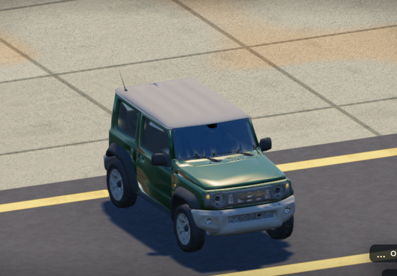
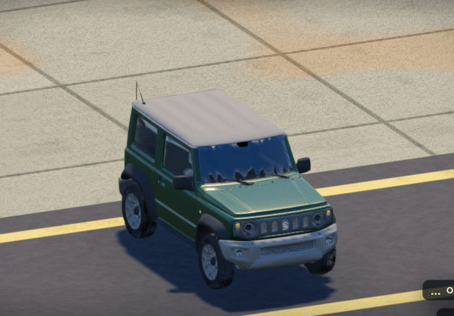
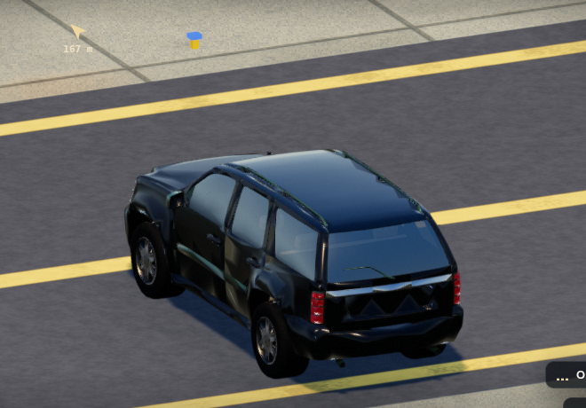
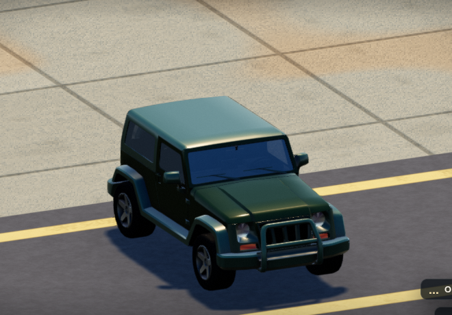
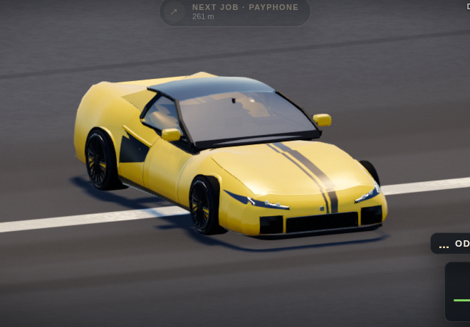
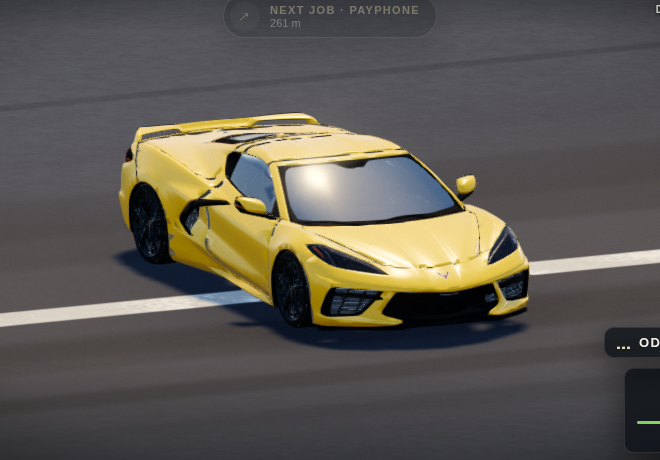
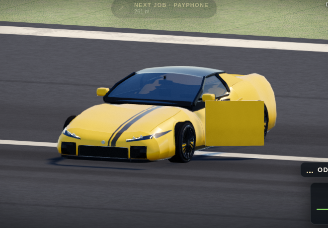
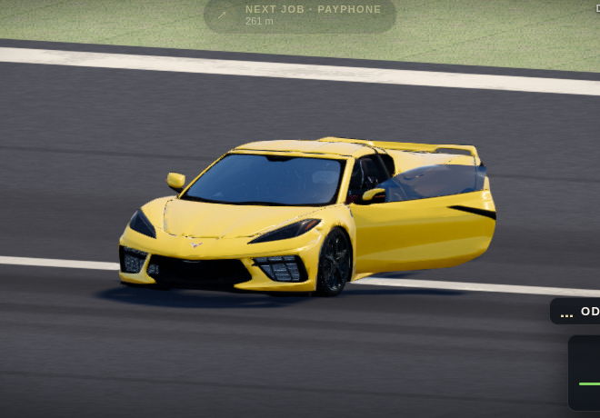

# Vehicle fidelity and general bug review — 15 October 2026

Development continues on `codex-reviews`, renamed at the owner's request on
October 15 from `codex/chase-clouds-polish-2026-10-12` with its history preserved.
The starting commit
was `7a0f6f3`; approved `origin/main` was `bde9ee4`. Main is not changed or published
by this review. Military changes are a proposal, with no military asset imported.

## Changes

1. **Jimny and related SUVs:** restore authored split normals and the Jimny's full
   near painted shell, panels and bonnet. Conversion had changed shading even at
   a reduction ratio of one. This produced the false dents and ripples visible
   below; a different supplier was not, by itself, the cause. Near SUV normals use
   signed 16-bit precision. Twenty zero normals in reduced SUV trim/cabin recover
   from nearby same-material source vertices, with positions/distances recorded.
2. **Chevette Z06:** replace the ordinary procedural body with Hari's free,
   CC BY 4.0 C8 Stingray source. Preserve its actual cabin, seats, instruments,
   mirrors, lights, indicators and native door layers. The separate carbon-aero
   Chevette SE keeps its existing body/equipment. The source is a Stingray, not a
   claim to an exact Z06 replica.
3. **Door openings:** remove the closed bodywork behind an open door and the filled
   panel that concealed the cabin. Move source paint/trim/window layers together,
   keep rear quarter glass, and restore source bodywork on closure/repair. Native
   C8 doors use authored hinges. Bullet marks retain source triangle anchors.
   Doors first constructed after a fire now register their inherited char materials
   for repair, including immediate repair and subsequent reopening.
   Exit animation now keeps the shoes above the rendered ground while the hips
   crouch; the old pose hid the shoes and lower trousers up to 21 cm underground.
4. **Occupied cabin:** fit the C8 driver and passenger to their different source
   cushions without resizing people. Keep more than 2 cm clearance around the
   tallest fitted heads. Fit hands to the actual steering rim, independently of
   the column pivot and seat side. Brake calipers follow the hubs/steering/springs
   while tyres and discs roll around them.
5. **General bugs:** clear retained right aim across thirteen modal transitions;
   prevent hidden/unfocused lift/records completion and respawn from returning to
   unattended play; preserve paid sportsbook progress/refunds across WASTED/BUSTED.
   Block live play and resume while WebGL is lost or awaiting the recovery reload,
   including travel and respawn that finish after the original context-loss event.
   [Reproductions and gameplay checks](gameplay-review.md).

## Efficiency and source preservation

The C8 source has 263,683 triangles across 119 primitives. Its shared game kit uses
85,031 near / 9,407 far triangles, with all active source roles assigned exactly
once. Low/Medium use 2048px atlases; High/Ultra 4096px. Three sports maps use about
64/256 MiB including mipmaps respectively, before other game textures. Tier changes
reuse texture objects, release resized GPU storage and reject stale image callbacks.
Source lamps/indicators share materials; native door layers reuse role ranges.
All four C8 lamps now select their actual far geometry. Whole-model traversal
confirms 9,407 far triangles; retaining near lamps had silently rendered 11,365.

SUV far levels remain 10,043 / 4,354 / 3,563 triangles. Their near counts are
122,277 / 7,951 / 6,502: the Jimny's close-view increase deliberately restores
painted detail. Distance/tier LOD, shared geometry and body pools remain in use.
Door partitions are cached; native hinge updates reuse a scratch vector. Open or
damaged doors keep the near body so LOD cannot close the aperture over the cabin.

All **302 approved motorcycle arrays**, all four existing albedo/ORM atlases, and
the original 23-model pack/atlas are unchanged. The sports motorcycle's successful
source model has not been replaced. Source assets, not an arbitrary smoothing or
double-sided-material workaround, define the corrected SUV surfaces.

These budgets and software WebGL checks do not establish laptop hardware FPS or
AAA production readiness. An M4 Max was not available for real-device profiling;
four uninterrupted normal-input mission wins remain unverified.

## Native SUV comparison

These are unretouched game PNGs at the same seed, clock, graphics, position and
camera. Each crop is 660×460 from a 1000×700 viewport. The before input is the
previous published runtime. The isolated after input replaces only the SUV binary
in that same runtime, which demonstrates the data correction independently of the
new door/C8 code. It is not relabelled as a final integrated build capture.

| Model | Before | Corrected source shading |
| --- | --- | --- |
| Jimny |  |  |
| Full-size SUV |  |  |
| Compact offroad |  |  |

The final SUV pack also repairs zero trim/cabin normals. All painted geometry and
normal arrays are identical to this render experiment, proved in
[the final repair receipt](verification/source-normal-repair-final.json).
Native dimensions and hashes: [image manifest](image-manifest.json). Camera,
identity, input hash and renderer errors: [before](verification/before-suv-review.json)
and [data correction](verification/normal-fix-suv-review.json).

## Integrated Chevette, doors and package checks

The final runtime is frozen as `dist/review-2026-10-15-final4.html`, SHA-256
`21403cd7c63950f619da9e8818a60be14ef306b0d08ced79ac336cd247c4df1a`.
[Final host checks](verification/final4-host.json) pass 38,948 assertions across
18 pure host modules. The complete hybrid `player-body` fixture also passes all
267 assertions in the actual FINAL4 browser. Its earlier host-adapter attempt is
retained separately and excluded from the pure-host gate.
[Package integrity](verification/package-contents-final4.json) confirms
CRC, all 105 assets byte-for-byte, and embedded source credits.

The [matched before](verification/runway-before-door-review.json) and
[integrated model review](verification/runway-after-door-review.json) pass all
eleven after captures, actual entry/exit, both native doors, night/wear/burn/repair,
source material/geometry restoration, and ten graphics/camera combinations.
The model review uses immutable FINAL2 (`7c7d8ba6…`); later fixes for lamp LOD,
late-created char layers, exit feet and GPU recovery have separate FINAL4 checks.
Model packs/textures/source normals/hinges are unchanged between those candidates.
The original 214-module baseline review completes with 196 PASS / 18 expected
no-WebGL SKIP, with unchanged quiet follow-ups resolving the two timing failures;
[gameplay evidence](gameplay-review.md) preserves the actual inputs and qualifications.

| View | Before | Integrated model/door correction (FINAL2) |
| --- | --- | --- |
| Chevette body |  |  |
| Driver door |  |  |

These two pairs have identical vehicle coordinates, heading, seed, camera and
13:09 clock. Other lifecycle images retain their actual time and state in the
receipts. The Jimny doorway captures are 13:23 before / 13:10 after, so use the
isolated normal comparison above for the strict body-shading match. FINAL2 exit
images retain the subsequently diagnosed foot clipping; do not label them FINAL4.

[Final GPU follow-up](verification/final4-runtime.json) passes **293 assertions**,
including all 267 original hybrid player-body checks. Actual C8 draws select 85,031
near triangles on High and 9,407 far triangles on both Low and Ultra. A previously unboarded car is burnt
before its first door construction, repaired and reopened; original source maps,
materials and geometry restore correctly. Real entry/exit images verify the feet
correction. Deliberate `WEBGL_lose_context` yields exactly one loss and restoration,
keeps play paused and blocks resume during recovery, with no frame fault or
unexpected browser error.

[Extracted-package smoke](verification/final4-smoke.json) passes real keyboard
walking and driving (16/24 world units, or 2/3 metres), the map, chase/street camera
switching and a visible FPS counter on the default settings. Its six native PNGs
are `images/smoke-*.png`; there are no browser errors. Both stages pass in
[the sequential pipeline](verification/corrected-render-pipeline.json).
The recorded low FPS is software WebGL in this cloud environment, not laptop
performance. The sole console warning is Three.js's existing UMD deprecation notice.

These **FINAL4 technical captures** use a full 960×600 viewport and retain their
actual lifecycle state; they are separate from the strictly matched FINAL2 table:

- [First door after a burn](images/final4-late-door-burnt.png) and
  [repaired/reopened](images/final4-late-door-repaired-reopened.png).
- [Exit midpoint with corrected feet](images/final4-exit-feet-midpoint.png) and
  [settled exit](images/final4-exit-feet-settled.png).

Detached red panel debris and sparks remain visible in this forced-wreck fixture:
clock-only test steps do not run debris physics. The native hood itself repairs
and closes correctly, independently verified in
[the actual-builder diagnosis](verification/hood-diagnosis/README.md). These are
technical lifecycle captures, not clean beauty pictures. The extra
`final4-c8-open-cabin-detail.png` is camera context, not a matched close-up; the
console clamps the requested zoom. All **47 accepted native PNGs** have byte hashes
and dimensions in the image manifest. Source previews elsewhere are labelled
separately. No image was retouched.

The first door-recorder attempt was invalid: `look` teleports out of land vehicles, and it was called after
boarding. It was stopped, retained as [harness evidence](verification/door-recorder-first-attempt.json),
and excluded from accepted images/results. A second fixture had correct boarding
but an airport building obscured the low camera; it is retained separately as
[obstructed evidence](verification/door-recorder-obstructed-attempt.json).
The accepted fixture stages `look` first, asserts the actual boarded vehicle,
uses real entry/exit actions, and puts every car on the clear runway at (418, 6000).

The managed browser serves local files over loopback HTTP; extracted-ZIP smoke
uses that same adapter. Package checks also verify exact expanded game source,
all static media bytes and credits. These checks are not direct `file://` launch
acceptance or real-device frame-rate measurements.

## Source, verification and continuation

- [Military proposal](military-proposal.md): HMMWV/M35 fidelity, cabins and LOD;
  optional licensed Chieftain source reference, explicitly not an Abrams replacement.
- [Sports source/conversion evidence](conversion-c8/README.md): licence, pinned
  27-file intake, exact role ownership, source texels, clean rebuild and previews.
  Source-model previews are labelled separately from in-game captures.
- [SUV conversion receipt](conversion-suv/approved-vehicle-conversion-receipt.json)
  and [source fixture gate](verification/source-fidelity-host.json).
- Runtime contracts: [source fidelity](../../areas/vehicles-and-driving-source-fidelity.md),
  [doors](../../areas/vehicles-and-driving-doors.md),
  [exit transitions](../../areas/vehicles-and-driving-door-transitions.md),
  [sports kit](../../areas/vehicles-and-driving-models-sports.md),
  [sports source recipe](../../areas/vehicles-and-driving-models-sports-source.md).
- [Handoff](../../HANDOFF.md) records the permanent branch, current work, source
  pitfalls, test limitations and the screenshot fixture correction for Claude.

The branch workflow produces a commit-specific public review ZIP. Extract it and
open `DeadEndCity/index.html`; this session cannot update the existing
`chatgpt.site` website. Source credits are embedded in every build.

## Further work toward the AAA goal

1. Profile representative driving, police chases and the fort on actual laptop
   GPUs, including an M4 Max at Ultra. Record frame-time percentiles, resolution,
   memory and loading time; tune screen-size LOD from those measurements.
2. Evaluate GPU-compressed texture delivery with browser-compatible fallbacks.
   The new source maps preserve detail, but atlas sharing and WebP download sizes
   do not reduce their decoded GPU memory to the same extent.
3. Continue a consistent art pass across vehicle interiors, characters, road
   materials and lighting, including the large close-view headlamp glows visible
   in the night capture. Finish uninterrupted normal-input mission playthroughs,
   save migration, long sessions and device/browser coverage before a production
   release. A few improved hero models do not establish the whole game's quality.
