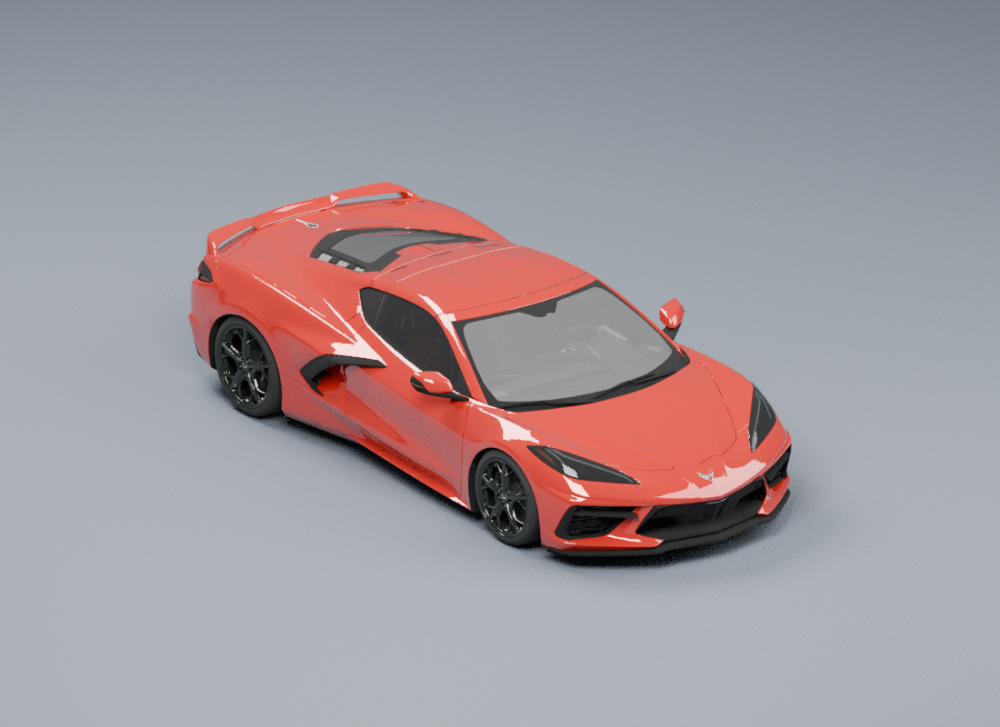
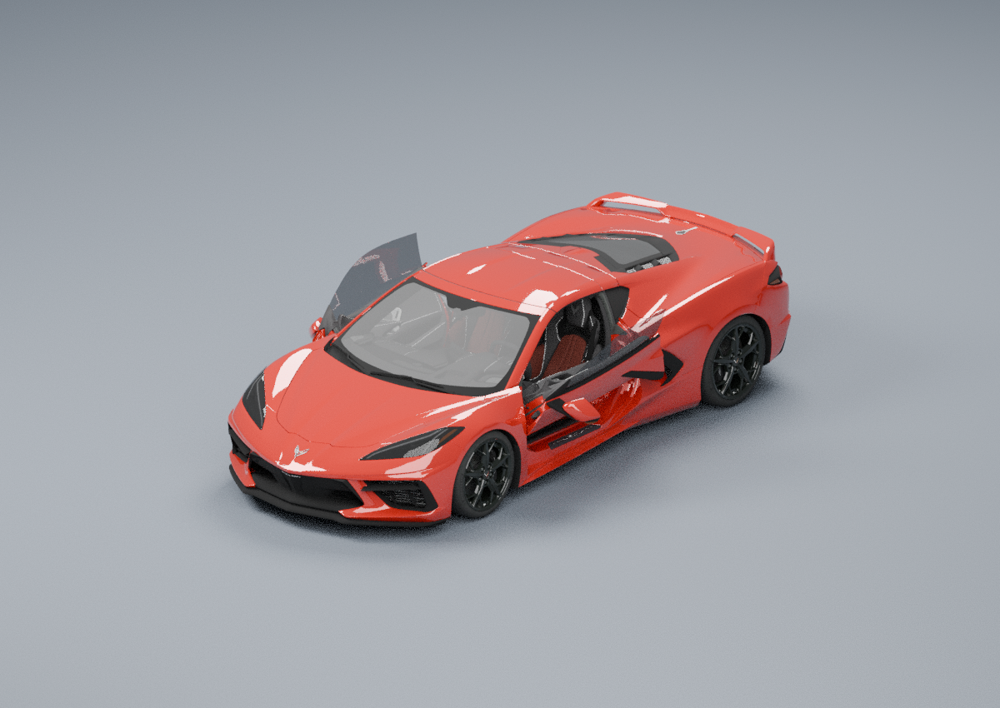
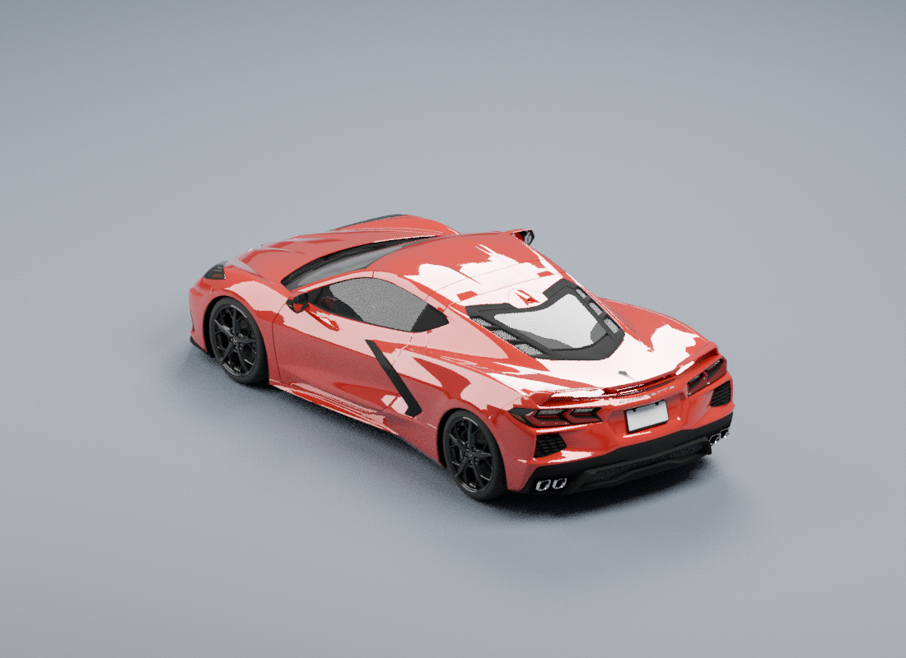

# C8 source conversion evidence

Selected sports pack SHA-256:
`e83f2d0f38b64ca743717eb50054ea15dfa56488fe8346ee423790815f375328`
(3,267,954 bytes). The six atlas hashes and sizes are in
[sports-conversion-receipt.json](sports-conversion-receipt.json). Existing original
23-model pack and original atlas hashes remain byte-identical in `protectedFiles`.

The source is Hari's **2019 Chevrolet Corvette C8 Stingray**, CC BY4.0, from the
pinned mirror documented in [source-download-receipt.json](source-download-receipt.json)
and [source-license.txt](source-license.txt). This is an asset-specific export
licence, not the unrelated repository code's licence. The original Sketchfab page
could not be independently accessed; the asset export's licence and GLTF metadata
agree. Required credit and the clean no-cache download/build/verify commands are in
[the sports source area document](../../../areas/vehicles-and-driving-models-sports-source.md).

Evidence:

- [sports-integrity-proof.json](sports-integrity-proof.json):1,188 structural/source
  checks on the selected pack, including exact near/Far active render ownership,
  every source face assigned once before reduction, complete attributes/panes,
  authored optical alpha and low-tier visible texels derived exactly from HQ.
- [sports-host-proof.json](sports-host-proof.json):1,228 checks using the production
  decoder, C8 builder, source-role index ranges, shader hooks, real wheel/caliper
  animation, LOD, texture quality/race/storage lifecycle and char/repair pool.
  Actual complete model draws85,031 near /9,407 far triangles, including all four
  source lamp Far parts; damage and player proximity restore their close geometry.
  The receipt includes tested runtime source hashes.
  This runs without a GPU and does not certify visual sorting or FPS.
- [source-partition.json.gz](source-partition.json.gz): gzip-compressed original
  source partition. Decompress with `python3 -m gzip -d FILE` on a copy. Every
  record identifies actual original primitive/triangle IDs;263,683 source faces,
  43 partitions, no dropped/duplicated face. Reduction deliberately changes the
  final near/far face count to85,031/9,407.
- [parts-manifest.json](parts-manifest.json), [parts-lookup.json](parts-lookup.json)
  and [parts-output.npz.json](parts-output.npz.json): actual per-part/pane reduction
  ratios and counts. The large generated NPZ caches are omitted; the documented
  clean command recreates them from verified source files.
- [source-normal-repairs.json](source-normal-repairs.json): five zero normals from
  collapsed decorative trim repaired from same-material authored vertices1.3–3.3mm
  away. Unreduced seats retain exact source arrays; other reductions transfer the
  original custom corner normals. Hero normal quantization is16-bit.
- [source-texel-proof.json](source-texel-proof.json):150 complete material/channel
  comparisons directly against original source images and linear material factors.
  Every visible albedo/alpha, ORM and emissive texel matches; the only deliberate
  pigment change is the untextured body respray template.
- [final-render-ownership-proof.json](final-render-ownership-proof.json): the final
  indicator-role correction changed metadata only; all618 source arrays and all
  six atlases remain identical to the preceding candidate.
- [model-metadata.json](model-metadata.json), [source-metadata.json](source-metadata.json)
  and [sports-models-header.json](sports-models-header.json): runtime measurements,
  source pivots, native door parts, aliases, glass pane counts and array schemas.
- [receipt-manifest.json](receipt-manifest.json): file/tool hashes and actual tool
  versions used. The common prepare-helper hash is also recorded in the conversion
  receipt; normal preservation depends on that helper's preserved-normal path.

The native source previews below were rendered offline in Blender with its source
materials. They are **source references, not game screenshots**; no source mesh was
exported after opening the authored doors. The open-door proof records original
and rotated parent matrices. Final game screenshots and GPU checks live in the
parent audit's rendering evidence.

