# Real before/after screenshots

Native browser captures of frozen main `bde9ee4` and the updated builds. The camera,
graphics preset and setup match within each pair. No images were generated or retouched.
M4 captures use the separately hashed military candidate; the final publication build
adds the checked records/lift held-aim fix, motorcycle rider contacts and terrain attachment
order. These later changes preserve the flat-scene M4 model and materials shown here.

The visible FPS counter reflects held/manual-clock SwiftShader capture conditions,
not laptop frame rates. [M4 camera, source hashes and image hashes](m4-screenshot-inputs.json)
record the exact inputs. These are developer inspection fixtures, not mission wins.

| M4 case | Before | After |
| --- | --- | --- |
| Materials and parked daylight lenses | 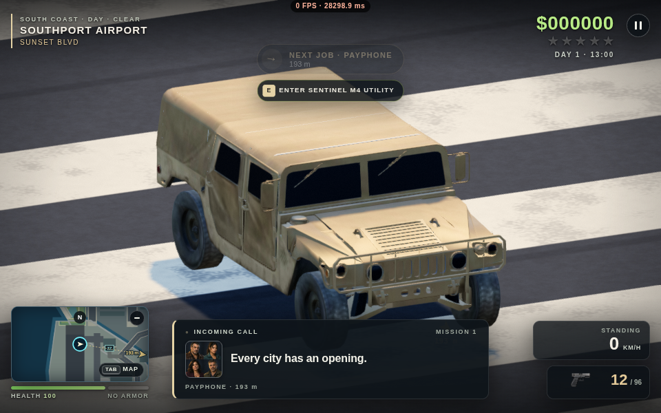 | 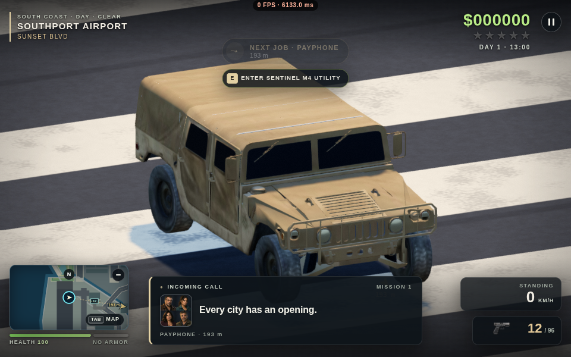 |
| Same movement interval | 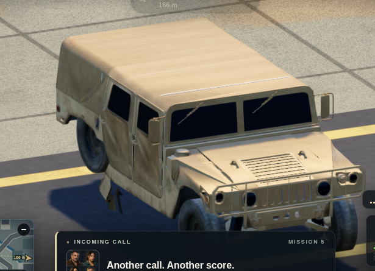 | 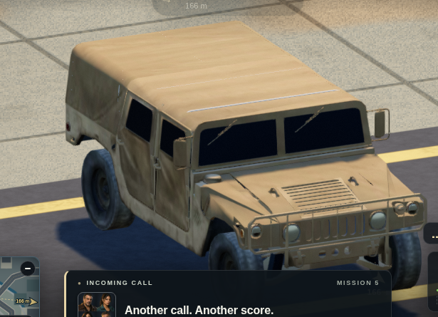 |
| Burn followed by repair | 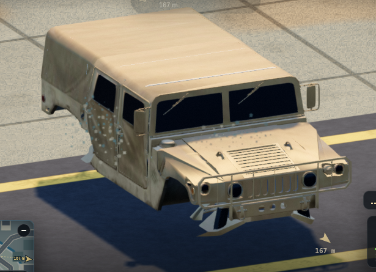 | 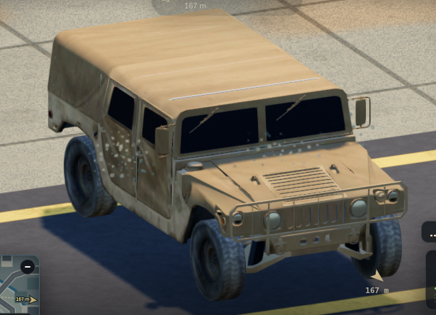 |

The repair pair visibly reproduces and fixes the hidden-tyre bug. The rolling rig's
full phase checks quantify the displaced axle: about 71.5 cm peak-to-peak rear-wheel
orbit becomes zero, while every original triangle and the rest pose are retained.

Motorcycle captures use the final runtime build directly (`b8d8713…`) versus
the same frozen main, with the same High preset, fixed inspection camera and timed
movement/damage fixtures. Crops are native screenshots at their original resolution.

| Motorcycle case | Before | After |
| --- | --- | --- |
| CB750 rubber-grip contact | 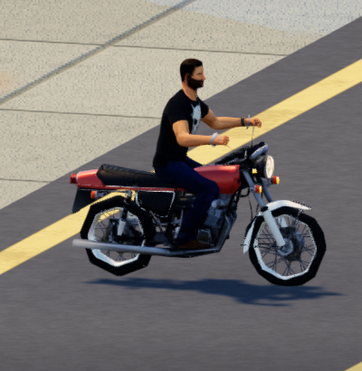 |  |
| Cruiser rubber-grip contact | 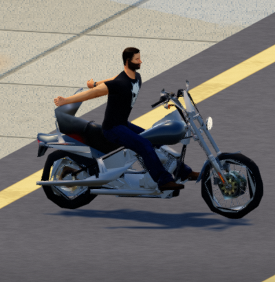 | 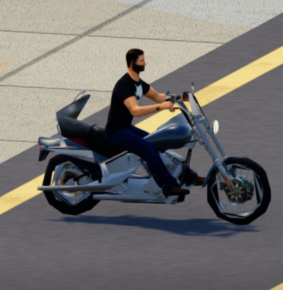 |
| Burn followed by repair | 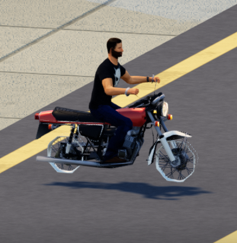 | 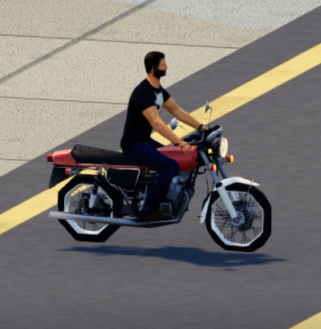 |
| KR 500 rolling | 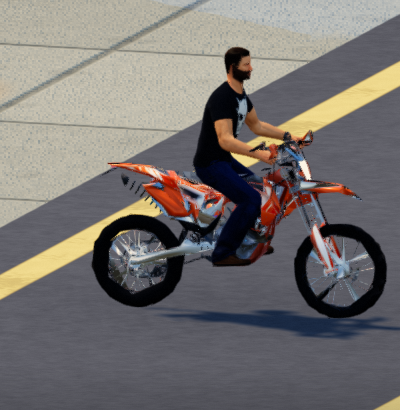 |  |
| KR 500 two real side shots | 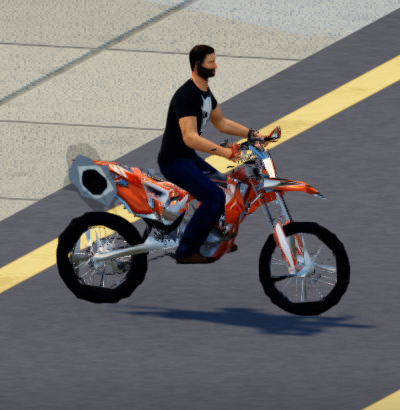 | 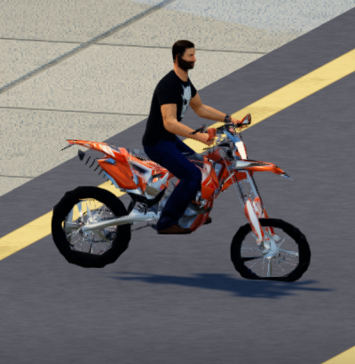 |

All three motorcycles completed six rendered stages each, with no console error,
frame fault or GPU context loss. The repaired models regain both tyre draws. The
KR 500 two-shot after receipt records `frontRight`; the same two-shot CB750/cruiser
stages are body hits with no puncture flag. The rolling host regression quantifies
axis wobble across full phases; a still image alone does not measure it. Rider reach
and source-rig limitations remain in [the rider audit](motorcycle-rider-review.md).

| CB750 chase-view damage fixture | Before | After |
| --- | --- | --- |
| Forty real right-side shots | 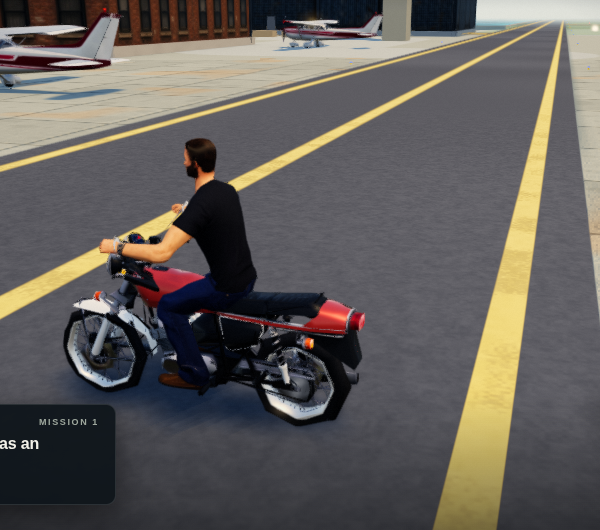 | 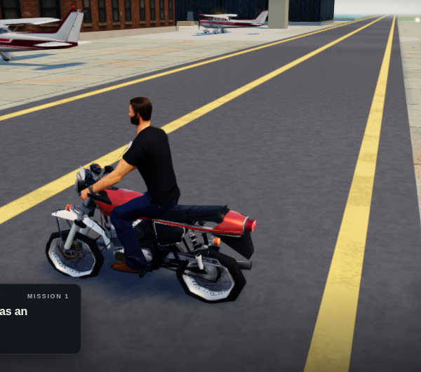 |

The supplemental damage receipts record `[]` before and `frontRight`, `rearRight`
after; both runs have zero console errors, frame faults or WebGL losses. The fixed
native crop retains a small mission-card fragment at the lower left. These are QA
captures. The final downloadable package differs from this runtime only by an
[updated plain-text asset credit](publication-credit-delta.json).
